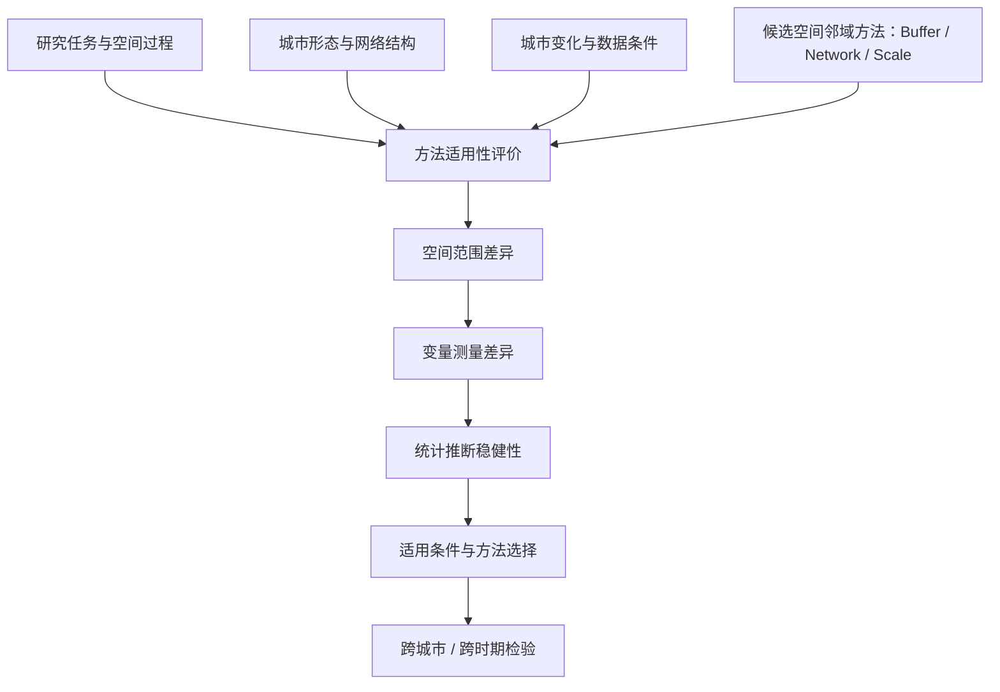
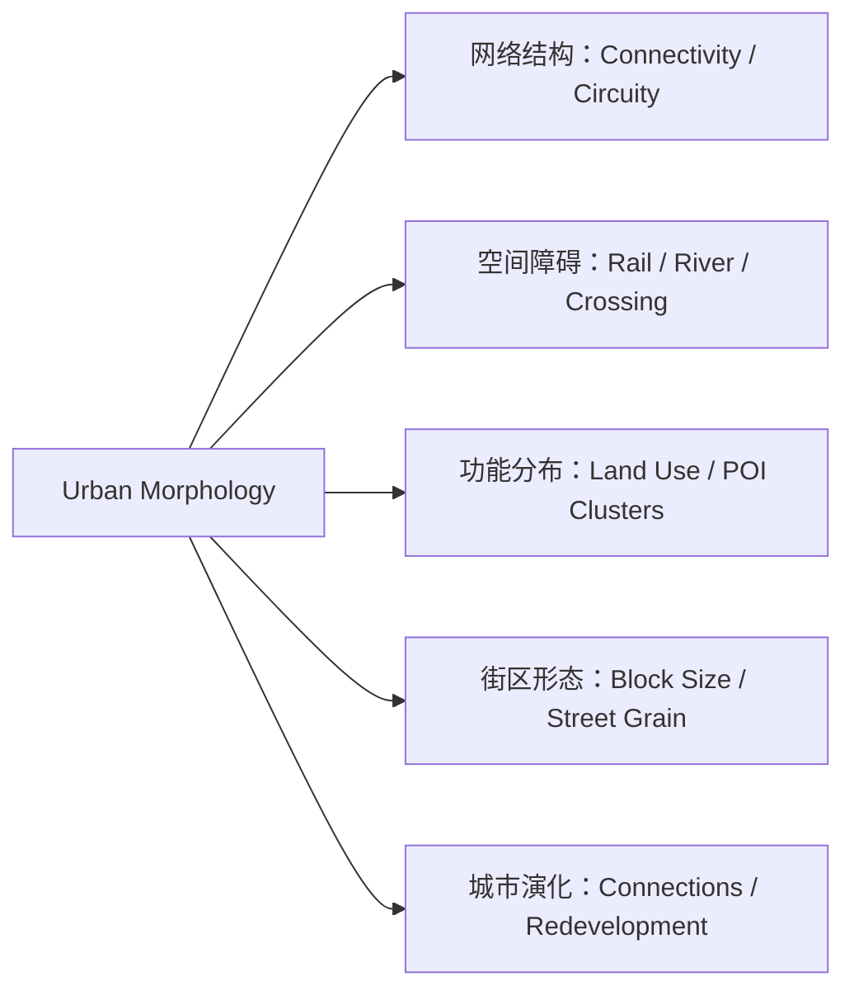
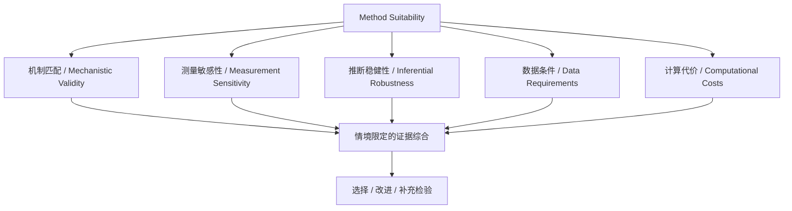

# 情境适应性空间分析：研究知识图谱（v2.0）

**Context-Adaptive Spatial Analysis**  
*Evaluating, Selecting and Improving Spatial Methods Across Diverse and Changing Urban Environments*

> 版本：2026-11-09 · 研究知识库 / Research Proposal 前期框架  
> 根据此前 10 页 PDF 转换整理；流程图使用可编辑 Mermaid 代码。非最终 Research Proposal，不引入机器学习。

**研究定位：** GIScience × Urban Morphology × Method Evaluation  
**理论基础：** UGCoP · MAUP · COSP · Error Propagation  
**方法主线：** GIS · Network Analysis · Monte Carlo · Spatial Statistics

**核心思想：** 从城市空间结构出发，以空间表征的测量后果和统计推断稳健性为依据，探索适用性可解释、可以跨城市验证的空间方法选择原则。

---

## 01. 研究定位与核心问题

从“发现方法差异”转向“解释何时适用、如何选择”
**核心研究问题：** 针对具体城市研究任务，不同城市形态、网络结构与发展变化如何影响空间分析方法的适用性？能否依据有解释力的证据选择或改进空间表征方法？

**概念主线**：Urban Context → Method Evaluation → Suitability Conditions → Method Selection / Adaptation
这一定位并不意味着“复杂方法一定更好”，也不预设某一城市形态必然对应某一种最佳方法。方法适用性必须相对于**研究任务、空间过程、数据条件和可接受的分析差异**定义。
## 02. 知识库总结构

九大模块及其逻辑关联

| ID  | 知识模块               | 核心知识节点                                               | 地位 |
|-----|------------------------|------------------------------------------------------------|------|
| K01 | 研究任务与空间过程     | Accessibility · Proximity · Spatial Exposure · Interaction | 核心 |
| K02 | Urban Morphology       | Connectivity · Block Structure · Barriers · Land Use       | 核心 |
| K03 | Spatial Representation | Euclidean Buffer · Network Catchment · Spatial Support     | 核心 |
| K04 | GIScience Theory       | UGCoP · MAUP · COSP · Spatial Scale                        | 核心 |
| K05 | Spatial Measurement    | Overlay · Zonal Statistics · Density · Count               | 核心 |
| K06 | Error & Uncertainty    | Data Error · Sensitivity · Error Propagation               | 核心 |
| K07 | Statistical Evaluation | Regression · Monte Carlo · Robustness · Equivalence        | 核心 |
| K08 | Method Selection       | Suitability · Trade-offs · Diagnostic Guidance             | 核心 |
| K09 | Urban Dynamics         | Urban Growth · Infrastructure Change · Transferability     | 扩展 |

### 模块之间的关键关系
**K01 → K03** — 研究目的与空间机制限制可采用的邻域定义：步行可达性与噪声/热暴露的空间过程并不相同。
**K02 → K03** — 城市路网、障碍与功能分布可能改变不同表征的结果，但其方向和强度必须检验。
**K03 → K05 → K07** — 表征方式首先改变空间变量，随后可能影响模型估计和统计结论。
**K04 + K06 → K07** — 理论与误差分析帮助区分真实误差、方法差异、聚合效应及数据问题。
**K07 → K08 → K09** — 稳健性评价支持情境限定的选择准则，再进行跨城市或时间变化检验。
## 03. Urban Morphology

把城市结构转化为可以检验的方法适用性解释因素

| 城市特征维度 | 候选量化指标                                                  | 与方法评价的潜在联系           |
|--------------|---------------------------------------------------------------|--------------------------------|
| 路网结构     | Intersection density、mean node degree、circuity              | 影响欧氏距离与网络路径的差异   |
| 空间障碍     | Barrier density、crossing availability、network discontinuity | 影响“近而疏”与服务区断裂       |
| 街区形态     | Mean block area、perimeter、street grain                      | 影响局部通行路径与空间范围     |
| 功能结构     | POI density、land-use entropy、spatial clustering             | 决定几何差异是否转成测量差异   |
| 时间变化     | New connections、land-use transition、connectivity change     | 检验方法适用条件随城市发展变化 |
**方法边界：** 城市形态指标的相关性不等于因果解释；OSM 路网完整性、跨越点、限制通行与历史数据时效性需要检查。**Spatial adaptability** 是当前优先研究内容，**Temporal adaptability** 为后续扩展。
## 04. Spatial Method Library

先聚焦邻域定义，再谨慎扩展到尺度和空间权重
### Neighbourhood Delineation · 第一优先级

**Euclidean Buffer**：按直线距离定义周边范围；**Network Catchment**：按路网距离或时间预算定义服务区；必要时纳入 Travel-time Isochrone。主要问题是它们在何种研究机制与城市结构下呈现可接受的一致性。
### Spatial Scale & Aggregation · 第二层

Buffer radius、grid resolution、zoning、distance decay。用于研究尺度效应、空间聚合与 MAUP / COSP 的联系；更换形状不等于必然发生 MAUP。
### Spatial Relationship Representation · 长期扩展

Distance-based / contiguity-based / network-based spatial weights。可进一步考察其对局部回归、空间相关分析和空间关系识别的影响；不必沿用神经网络方案。
### 理论支架的准确位置

| 理论              | 在本研究中的作用                     | 不得混淆之处                             |
|-------------------|--------------------------------------|------------------------------------------|
| UGCoP             | 讨论相关地理情境、邻域定义的不确定性 | 比较多种 buffer 不能直接找到真实 context |
| MAUP              | 讨论尺度与分区的聚合敏感性           | 不等于任意不规则邻域问题                 |
| COSP              | 讨论不同空间支撑间的数据转换         | 与 MAUP 有联系但不等价                   |
| Error Propagation | 考察差异通过变量测量传至统计推断     | 无真值时“差异”不能直接称为“误差”         |
**必须先定义研究任务**：步行可达性、视觉暴露、空间活动关联和行政资源配置所对应的“合适邻域”不可能完全相同。
## 05. 方法适用性评价

先考虑研究机制，再比较测量后果和稳健性

| 维度                        | 要回答的问题                       | 候选证据                       |
|-----------------------------|------------------------------------|--------------------------------|
| Mechanistic appropriateness | 方法是否表达研究所关心的空间过程？ | 可达路径、暴露机制、理论假设   |
| Measurement sensitivity     | 改变表征是否实质改变变量测量？     | 差值、相对变化、排名稳定性     |
| Inferential robustness      | 空间选择是否实质改变统计结论？     | 系数差、CI、等效性/容忍范围    |
| Data requirements           | 依赖的数据是否完整、及时且可比？   | 拓扑完整性、缺失率、年代一致性 |
| Computational costs         | 复杂方法是否带来值得的实际增益？   | 耗时、数据准备与增量收益       |

### 两个判断阶段
**01 · Mechanistic screening**：先判断方法假设与研究目的是否相容。不能因为某一模型 R² 更大，就认定其空间定义更“真实”。
**02 · Empirical robustness**：对于概念上合理的方法，再比较空间、测量、推断结果及数据与计算代价。
$D_G$ = Geometry discrepancy   ·   $D_X$ = Measurement discrepancy   ·   $D_{\\theta}$ = Inferential discrepancy
上述均为评价维度而非现成统一指标；若没有独立参照或确定的研究机制，不能由 $D_G$、$D_X$、$D_{\\theta}$ 直接推断哪种方法更准确。
## 06. 待验证机制与研究假设

连接城市形态、空间表征、误差传播和方法适用性
| 假设 | 拟检验的关系                                      | 可能机制                                  |
|------|---------------------------------------------------|-------------------------------------------|
| H1   | Network Structure → Geometric Discrepancy         | 路网连通性及绕行造成邻域范围差异          |
| H2   | Geometry × Functional Heterogeneity → Measurement | 属性集聚位置决定几何差异是否变成测量差异  |
| H3   | Measurement × Model Specification → Inference     | 协方差、聚合、估计过程影响系数/区间稳定性 |
| H4   | Morphology × Spatial Scale → Suitability          | 方法差异可能随城市形态和尺度发生变化      |
| H5   | Urban Structural Change → Suitability Change      | 新增道路/桥梁可能改变方法适用条件         |
Urban structure
路网、障碍、功能分布
→
Representation
范围、尺度、支撑
→
Measurement
Count、Density、Mean
→
Inference
β、CI、解释结论
### 为什么要研究“放大、减弱和抵消”？

两组空间邻域即使在几何上很不相同，如果属性分布近似均匀，测量结果仍可能接近；反过来，较小的边界差异若包含关键设施集聚区，也可能造成明显的变量差异。变量差异还可能通过模型的统计结构被放大或抵消。这些情形均属于**研究假设，不是预设的实证事实**。
**统计原则**：两种方法得出“不显著不同”的结果，不代表已经证明等价。稳健性应针对预先说明的研究目标、估计量和可接受容忍度作出判断，并考虑同一批地点多方案估计的依赖及空间相关性。
## 07. 拟议的博士研究设计

Evaluate → Explain → Guide Selection
**STUDY 01**
### Urban Morphology & Representation Sensitivity

比较不同城市形态下 Euclidean / Network neighbourhood 的几何差异及 POI、土地利用等测量敏感性。

**方法：** GIS · Network Analysis · Controlled Comparisons  
**产出：** 空间差异分布及影响因素的初步解释。
**STUDY 02**
### Mechanisms of Uncertainty Propagation

使用已知真值的模拟设置，改变城市网络形态、属性异质性、空间尺度与统计设定，区分差异传播中的放大、减弱与抵消。

**方法：** Monte Carlo · Factorial Design · Spatial Statistics  
**产出：** 条件性传播机制、估计偏差与不确定性分析。
**STUDY 03**
### Context-Adaptive Method Selection

综合前两阶段证据，研究可解释的适用条件；对不同城市或变化中的道路结构检验规则是否可迁移。

**方法：** Robustness Analysis · Equivalence Criteria · Cross-city Validation  
**产出：** 有限适用范围内的评价/选择准则，而非保证统一阈值。
### 推荐的最小 Pilot
**1.** 选择城市中路网形态不同的区域
**2.** 固定研究点与空间数据
**3.** 生成可比的 Euclidean / Network 邻域
**4.** 计算连通性、绕行和障碍指标
**5.** 比较 overlap 与变量差异
**6.** 检验城市结构是否解释敏感性
## 08. 关键文献与知识来源

按本研究现阶段的关联性排序；链接可点击

| 顺序 | 核心文献                                                                                                                                   | 知识用途                        |
|------|--------------------------------------------------------------------------------------------------------------------------------------------|---------------------------------|
| 01   | [Zare Sakhvidi et al. (2025)](https://doi.org/10.1016/j.lanplh.2025.101370) · Buffer selection guidance                                    | 研究目的、过程机制与情境选择    |
| 02   | [Li et al. (2022)](https://doi.org/10.1186/s12942-022-00310-7) · Euclidean vs Network Buffers                                              | 下游测量与回归估计差异          |
| 03   | [Boeing (2020)](https://doi.org/10.1177/2399808318784595) · 27,000 urban street networks                                                   | 城市路网结构指标与多尺度比较    |
| 04   | [Boeing (2019)](https://doi.org/10.1007/s41109-019-0189-1) · Urban Spatial Order                                                           | 路网朝向、连通性及空间结构      |
| 05   | [Kwan (2012)](https://doi.org/10.1080/00045608.2012.687349) · Uncertain Geographic Context Problem                                         | UGCoP 基础理论                  |
| 06   | [Fotheringham & Wong (1991)](https://doi.org/10.1068/a231025) · MAUP                                                                       | 空间聚合与统计敏感性            |
| 07   | [Duque et al. (2018)](https://doi.org/10.1371/journal.pone.0207377) · S-maup                                                               | 既有敏感性检验与指标            |
| 08   | [Kedron et al. (2022)](https://doi.org/10.1080/03098265.2021.1901076) · Specification Curve                                                | 多重合理设定的稳健性分析        |
| 09   | [Pais et al. (2025)](https://www.rcaap.pt/v1/detail.jsp?id=oai%3Arepositorioaberto.uab.pt%3A10400.2%2F19968) · Walking to Public Transport | 可达性与替代缓冲区              |
| 10   | [Li et al. (2026)](https://doi.org/10.1080/13658816.2026.2727960) · Beyond Geographical Proximity                                          | 空间邻近关系/权重扩展的前沿参照 |
**文献使用说明**：以上沿用前一版知识图谱的文献清单与入口，作为研究阅读导航。正式 Research Proposal 需要逐篇核对其论证范围、期刊元数据、方法限制和真正未被解决的问题；特别避免把“已有指标”或“方法组合”直接声明为首次创新。
## 09. 学习路线与研究定位

按知识依赖顺序搭建可持续更新的研究知识库
**01.** Research Constructs  
— 研究任务、空间机制与待估计量
**02.** Urban Morphology  
— 路网结构、空间障碍、功能分布
**03.** Spatial Representation  
— Buffer、Network、Scale、Support
**04.** UGCoP / MAUP / COSP  
— 区分情境不确定性与聚合问题
**05.** Spatial Measurement & Propagation  
— 差异、敏感性与模拟真值
**06.** Inference & Method Selection  
— 稳健性、适用条件、跨城验证
### 推荐的知识节点笔记结构

| 字段                  | 需要记录的内容                       |
|-----------------------|--------------------------------------|
| Concept               | 定义、原始文献、与相近概念的区别     |
| Mechanism             | 它通过什么空间/统计过程影响结果      |
| Metrics / Methods     | 如何操作化、有哪些测量条件           |
| Evidence / Hypothesis | 已有文献证明了什么；哪些只是我的假设 |
| Research relevance    | 对应哪个 RQ、Study 或研究产出        |
| Limitations           | 真值、数据质量、尺度、任务与外推边界 |
最终研究定位

### Context-Adaptive Spatial Method Evaluation and Selection

以 Urban Morphology 为主要解释维度，以 Spatial Neighbourhood Representation 为首要方法对象，以 Measurement and Inferential Robustness 为评价依据，以可解释、可检验的方法选择准则为潜在综合贡献。
本文件为面向博士研究方向讨论的知识图谱。研究假设、适用条件与创新性均需要系统文献综述、模拟实验和城市实证进一步验证；不使用机器学习作为当前研究路线。
