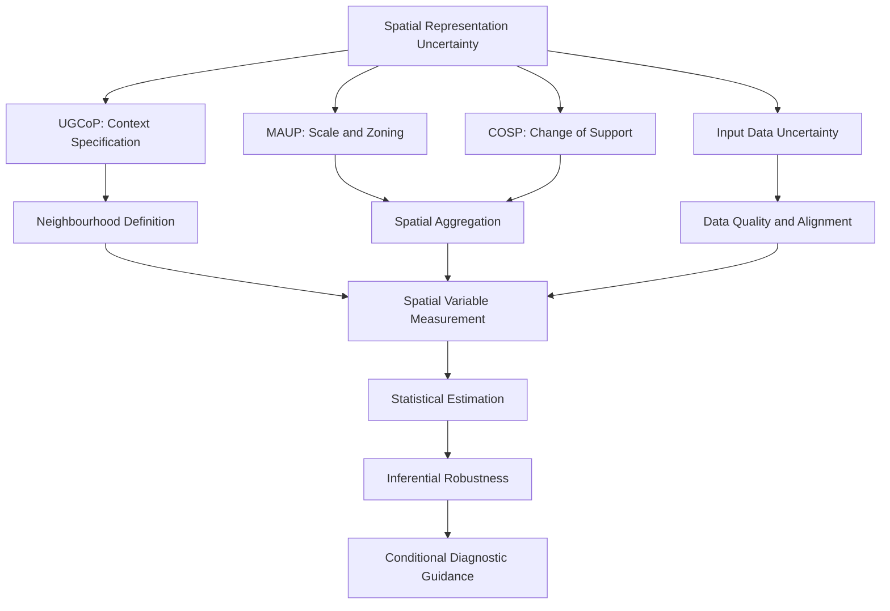
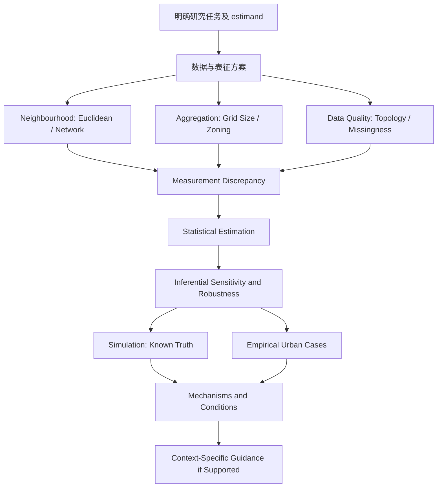

# PhD Research Direction & Knowledge Base

## 空间表征不确定性及其向地理分析结论的传播

**Working title:** *Understanding When Spatial Representation Uncertainty Becomes Analytically Consequential*  
**Alternative title:** *Spatial Representation Uncertainty and Its Propagation into Urban Spatial Analysis*  
**研究定位：** GIScience × Spatial Statistics × Urban Analytics  
**文档性质：** 博士研究方向工作笔记 / Research Proposal 前期框架（非最终 RP）  
**版本：** v1.0 · 2026-11-09  
**整理基础：** 用户精选的 `RP.md`；保留其中的核心观点，消除重复，并按照“研究问题—理论—机制—方法—知识库”重新组织。文献链接主要沿用源文件；本版未逐篇重新核验出版元数据或全文结论。  
**技术边界：** 暂不采用机器学习；优先使用 GIS、控制实验、Monte Carlo simulation、传统统计与空间统计方法。

---

## 0. 一页概览：目前究竟想研究什么？

### 0.1 核心问题（最重要）

> **为什么同样类型的空间表征变化，有时会显著改变统计结论，有时却几乎没有影响？这种差异通过什么机制被放大、减弱或抵消？在什么条件下，简化的空间表征足以支持稳健的分析结论？**

对应英文：

> *Why do changes in spatial representation sometimes substantially alter statistical conclusions, while having negligible effects in other cases? Through what mechanisms are such differences amplified, attenuated, or offset, and under what conditions can simpler representations yield sufficiently robust conclusions?*

研究思想的演化：

```text
城市中“近而疏”的现象
       ↓
圆形 Buffer 不一定代表实际步行可达范围
       ↓
不同 neighbourhood definitions 会得到不同测量结果
       ↓
但空间差异 ≠ 测量差异 ≠ 统计推断差异
       ↓
问题不是“哪个永远更准确”
       ↓
识别差异为何被放大、减弱或抵消
       ↓
检验何时不同表征在特定任务上足够稳健
       ↓
可能建立可解释、带适用条件的敏感性评价准则
```

**研究主线：**

**Identifying uncertainty → Explaining its consequences → Evaluating robustness**  
**识别不确定性 → 解释其后果 → 评价结论稳健性**

### 0.2 当前推荐的课题边界

- **核心研究对象：** 空间表征选择对空间变量构建及统计推断的影响，尤其是其传播机制与条件性稳健性。
- **首要切入点：** Neighbourhood/context specification（Euclidean buffer、network catchment、尺度、距离衰减）。
- **第二理论维度：** MAUP / spatial support（聚合尺度与分区），用于检验与 neighbourhood specification 的独立和交互作用。
- **方法学主干：** Controlled comparisons + Monte Carlo simulation + factorial/sensitivity analysis + spatial statistical inference。
- **首选应用场景：** 城市交通设施及其周围建成环境的测量（仅作为候选案例，不预设为唯一应用）。
- **可能的实践成果：** 有研究任务限制和不确定性说明的 Spatial Representation Sensitivity / Robustness Diagnostic；**不预设统一阈值**。

### 0.3 本研究目前不主张什么

1. 不主张 Euclidean buffer 在任何研究中都“错误”，network catchment 在任何研究中都“正确”。
2. 不把不同方法产生的差值直接称为“真实误差”（没有参考真值时，它首先是 **discrepancy / sensitivity**）。
3. 不把 UGCoP、MAUP、COSP 视为同一种问题。
4. 不认为首次比较 buffer、首次研究 MAUP 或首次讨论误差传播能够构成博士原创性。
5. 不预先规定“指数大于 0.5 就不能用 buffer”之类的通用硬阈值。
6. 不因加入复杂算法而自动认为研究更有价值；**本研究当前排除 ML**。

---

## 1. 研究方向的定位与演化

### 1.1 从具体 GIS 问题到 GIScience 问题

最初的观察是：地铁站周围 800 m 的圆形缓冲区，可能把隔河、隔铁路或需要大幅绕行的空间一并计入；步行网络服务区则呈现不同形状。但**形状不同不等于后续统计结论必然不同**。

因此，研究不再停留于：

> *How different are Euclidean and network catchments?*

而转向：

> *When and why does a difference in spatial representation become analytically consequential?*

具体区分三种不同的变化：

| 层次 | 研究对象 | 关键提问 | 典型观测量 |
|---|---|---|---|
| **Spatial discrepancy** | 空间范围与邻域成员 | 边界、覆盖关系究竟改变多少？ | Jaccard、面积差、邻域成员变化 |
| **Measurement discrepancy** | 空间变量的计算结果 | 边界改变是否实质影响 POI、人口、土地利用等统计？ | 变量差、相对变化、排序变化 |
| **Inferential discrepancy** | 模型估计与研究结论 | 变量变化是否传播成系数、CI 和结论变化？ | 系数差、CI、区间覆盖、结论稳健性 |

**核心命题（待验证，不是预设结果）：**
```
[\text{Large Spatial Discrepancy}\;\not\Rightarrow\;\text{Large Inferential Discrepancy}\] 
```


空间差异可能与属性异质性、变量构造规则和统计模型共同作用，出现**放大、减弱、相互抵消**。

### 1.2 推荐以 A 为主、B 为扩展

**方向 A（优先）：** *Uncertainty Propagation from Neighbourhood Specification to Spatial Inference*  
重点研究 context/neighbourhood definition 的变化，借助模拟与城市案例识别传播机制和条件性稳健性。范围更容易控制。

**方向 B（延展）：** *Interactions Between Geographic Context Uncertainty and the Modifiable Areal Unit Problem*  
进一步把 spatial support / aggregation 引入设计，检验 UGCoP 相关的 context specification 与 MAUP 相关的 aggregation 是否发生交互。理论更宽，混杂与实验设计难度也更高。

当前推荐将 **A 作为研究主干，B 作为可检验的扩展模块**；是否升级为同等主轴，取决于文献核查、数据和导师反馈。

---

## 2. 核心概念与理论关系

### 2.1 UGCoP — Uncertain Geographic Context Problem

**关键词：** Geographic context、Neighbourhood effects、Exposure context、Spatial-temporal uncertainty。

核心关切：研究者划定的空间情境是否对应实际发生作用的地理范围与时间范围？例如以居住点圆形缓冲区代表个人活动或设施可达范围，可能出现情境错配。

\[
\text{Assumed Geographic Context}\neq\text{True Relevant Context}
\]

**重要边界：** 在真实数据里，所谓 *true relevant context* 可能无法直接观察。比较多种邻域定义，只能证明对 context specification 存在敏感性；不能据此宣布找到真值。

主要阅读：Kwan (2012)。

### 2.2 MAUP — Modifiable Areal Unit Problem

**关键词：** Scale effect、Zoning effect、Aggregation、Spatial support。

- **Scale effect：** 100 m、250 m、500 m、1 km 网格，或不同级别行政区，可能产生不同统计结果。
- **Zoning effect：** 即使单元的面积/数量相近，仅改变分区边界或网格起点，也可能影响统计。

**重要边界：** 将 800 m 圆形 buffer 改成 800 m 网络服务区，若没有改变聚合单元，主要是 neighbourhood/context specification；不能因为边界变形就简单把它称为 MAUP。

主要阅读：Fotheringham & Wong (1991)；Openshaw (1983)。

### 2.3 COSP — Change of Support Problem

**关键词：** Spatial support、Areal-to-areal conversion、Point-to-area aggregation、Misalignment。

关注来自不同空间支撑的数据，如何转换到新的分析单元，以及转换中的不确定性。例如将行政区人口分配到站点服务区，可能需要插值/分配假设。

**与 MAUP 的联系：** MAUP 强调可变聚合单元引起的统计变化；COSP 更直接关心不同支撑尺度或类型的数据推断与转换问题。

主要阅读：Gotway & Young (2002)。

### 2.4 Error / Uncertainty Propagation — 误差与不确定性传播

研究一项空间处理或测量中的不确定性如何经由后续运算传至模型参数或研究结论。

\[
\text{Representation}\rightarrow\text{Measurement}\rightarrow\text{Estimation}\rightarrow\text{Conclusion}
\]

**区分三个词：**

| 概念 | 本研究中的严格用法 |
|---|---|
| **Error（误差）** | 与已知真实值/可靠参考值的偏离；通常需模拟真值或明确的验证数据 |
| **Uncertainty（不确定性）** | 真值、数据或模型设定不确定造成的可能结果范围 |
| **Sensitivity / Discrepancy（敏感性/差异）** | 改变合理设定时输出变化的幅度；本身不证明哪种方案错 |
| **Robustness（稳健性）** | 一项具体结论在一组合理设定下是否维持，需预先说明判定标准 |

主要阅读：Heuvelink (1998)。

### 2.5 相关但不宜混同的概念

- **NEAP — Neighborhood Effect Averaging Problem：** 进一步涉及基于居住地的情境测量与实际活动空间之间的平均化问题；若不研究行为活动空间，暂列进阶背景。
- **Ecological Fallacy：** 从聚合数据关系推断个体关系的风险；是与 MAUP 相关但不同的推断错误。
- **Spatial Autocorrelation / Spatial Heterogeneity：** 一方面可能影响测量差异的空间分布，另一方面会影响估计、标准误及敏感性分析。
- **Spatial Weight Matrix：** 描述邻近/相互作用关系的数学表征；与 buffer 的空间截取问题相关，但不等价。Li et al. (2026) 可作理论边界参照，不沿其 ML 路线。

### 2.6 知识关系图（理论层）



*注：此图为本研究的综合概念框架，并非某一篇文献已经提出的完整模型。*

---

## 3. 研究核心：差异如何传播、被放大或被抵消？

### 3.1 表示与测量的形式化

设位置 \(i\) 的邻域为：

\[
B_i^{(c,r)}
\]

其中 \(c\) 是邻域的定义方式（例如 Euclidean / network），\(r\) 是合理的尺度或成本阈值；\(Z(s)\) 是空间属性场（POI、人口、建筑、土地利用等），\(T\) 是 Count、Mean、Sum、Density 等空间汇总算子。

\[
X_i^{(c,r)}=T\big(Z(s),B_i^{(c,r)}\big)
\]

不同定义下的变量差异为：

\[
\Delta X_i=X_i^{(E)}-X_i^{(N)}
\]

强调：此式得到 **measurement discrepancy**，不是在未知真值条件下得到绝对测量误差。

### 3.2 从变量变化到统计推断变化

对于固定研究任务与结果变量 \(Y\)，考虑相同规格的统计模型：

\[
Y_i=\beta_0+\beta_1X_i+\varepsilon_i
\]

更换邻域定义，得到：

\[
\Delta\hat\beta=\hat\beta^{(E)}-\hat\beta^{(N)}
\]

同时比较效应大小、置信区间、标准误、模型诊断和研究解释。**不能只看 p 值是否跨越 0.05**；也不应直接认为模型拟合更好就证明 context 更真实。

### 3.3 待检验的传播机制

| 候选机制 | 可观察特征 | 为什么可能影响传递 | 研究状态 |
|---|---|---|---|
| 空间属性异质性 | POI/人口是否集聚，密度梯度 | 边界差异区域恰好包含重要集聚点，会造成较大测量差 | 待检验假说 |
| 网络通达性与障碍 | Detour、河流、铁路、断头路、跨越点 | 决定 E/N 邻域差异的空间结构 | 机制已知，但下游影响须检验 |
| 汇总算子 | Count vs Density vs Mean | 不同算子对面积与边缘对象敏感度不同 | 待系统比较 |
| 空间聚合/支撑 | Grid size、shifted grids、行政边界 | 可能平滑或重组变量与关系 | 文献已有先例，交互问题待明确 |
| 变量相关结构 | 变量之间的协方差、空间自相关 | 测量差异可能改变估计稳定性 | 待明确识别机制 |
| 模型设定 | 全局模型 vs 空间回归 | 推断对数据变化的响应可能不同 | 待控制比较 |

四种理论上可能的情况（**不应先验当作实证规律**）：

| 几何差异 | 变量差异 | 推断差异 | 意义 |
|---|---|---|---|
| 小 | 小 | 小 | 简单方法可能足够 |
| 大 | 小 | 小 | 几何形状不同但下游影响有限 |
| 小 | 大 | 大 | 小范围内的关键要素可能造成放大 |
| 大 | 大 | 小或大 | 还取决于模型与变量的统计结构 |

### 3.4 多种不确定性的主效应与交互

令：

\[
\hat\theta=f(C,U,Q,M)
\]

- \(C\)：Context specification（邻域定义/尺度/距离衰减）；
- \(U\)：Spatial support / aggregation（聚合尺度及分区）；
- \(Q\)：Input data quality（位置、属性、路网拓扑或时效性）；
- \(M\)：Model specification（统计模型及其约束）。

目标不是简单展示大量组合，而是识别：

\[
\Delta\hat\theta_C,\quad\Delta\hat\theta_U,\quad\Delta\hat\theta_{C\times U}
\]

其中 \(C\times U\) 表示邻域定义影响是否依赖于聚合尺度。具体“影响份额”需要与实验设计、模型和重复抽样单位相匹配，不能不加条件地把一次 ANOVA 结果解读为普遍的因果贡献。

### 3.5 “等价”比“不显著不同”更难也更重要

- “没有统计显著差异” ≠ “已证明可以互换”。
- 若研究要声称“简化方法足够好”，需定义何种**实质影响**可被接受。
- 可探索 **Equivalence Testing / Tolerance-based robustness**；但等价容忍度 \(\delta\) 应由研究问题、单位及用途预先说明，不能从结果倒推以求得有利结论。
- 因为两种空间表征通常用的是同一批地点/数据，比较估计量时需考虑**成对依赖**与**空间相关性**，不能把它们当成两组独立样本。

---

## 4. 研究缺口（Research Gap）：分层论证，而不是宣称“无人研究”

### 4.1 已有研究足以说明什么？

| 已有方向 | 不能再作为独占性创新的主张 | 主要代表文献 |
|---|---|---|
| UGCoP | 不能宣称首次发现真实地理情境可能被错误界定 | Kwan (2012) |
| MAUP | 不能宣称首次发现聚合尺度/分区影响模型结果 | Fotheringham & Wong (1991) |
| GIS error propagation | 不能宣称首次研究不确定性如何传入 GIS 分析 | Heuvelink (1998) |
| Buffer size/shape sensitivity | 不能宣称首次比较 circular/network 或不同 buffer 尺度 | James et al. (2014), Li et al. (2022) |
| MAUP 敏感性诊断 | 不能宣称从未出现“输入数据→敏感性检验/临界值”的方法 | Duque et al. (2018), S-maup |
| 多规格分析与不确定性 | 不能宣称首次系统比较多个合理研究规格 | Steegen et al. (2016), Kedron et al. (2022) |
| 多种空间不确定性的交互 | 不能宣称无人比较 contextual characteristics、spatial scale 的相互影响 | Conceicao et al. (2026)；应进一步查全文 |

### 4.2 四条可继续检验的 Gap

**A. Uncertainty Propagation Mechanisms（首要）**  
为什么同等规模的 neighbourhood discrepancy 在不同城市、属性分布和统计模型中会被放大、衰减或抵消？能否明确分辨传播发生在哪个环节？

**B. Interactions Between Uncertainties（扩展）**  
Context delineation 与 spatial support 是否存在显著交互，何时这种交互会影响下游结论？既有研究已有相关先例，必须先明确比前人多解决了什么。

**C. Conditional Analytical Robustness（首要）**  
在给定分析目标与容忍度的情况下，何时不同空间表征产生的结论可被认定为足够稳健/实质等价？

**D. Decision-Oriented Spatial Diagnostics（后期产出）**  
是否可以把 A+C 的发现转化为可解释、任务限定的诊断指引，帮助选择简化或复杂的空间表征？不以单一通用 score 或统一阈值为必达目标。

### 4.3 目前最有防御性的研究缺口表述

> *Previous studies have shown that geographic context definitions, spatial aggregation and data-processing choices can influence geographical measurements and statistical inference. However, a question worth investigating further is why comparable changes in spatial representation lead to substantial inferential differences in some settings but negligible differences in others. This study would examine the mechanisms of amplification and attenuation and evaluate the conditions under which conclusions remain analytically robust.*

**解释：** 这是**待验证的 gap / research motivation**，不是在完成系统综述后得到的“无人研究”结论。博士原创性最终须落到新的、可检验的传播机制、条件性规律或有证据支撑的诊断方法。

### 4.4 决定性“撞题”文献与必须回答的问题

1. **Li et al. (2022)**：已有 buffer → exposure → regression bias；本研究如何超越两种方案的对比？
2. **Duque et al. (2018)**：已有 MAUP 敏感度检验；本研究为何不是换指标名称？
3. **Kedron et al. (2022)**：已有 specification-curve 思想；本研究能揭示何种机制而非仅展示结果范围？
4. **Conceicao et al. (2026)**：已有 contextual measurement × spatial scale 交互；本研究需区分具体地理过程或推断目标。
5. **Comess et al. (2026)**：已有空间变化的 buffer radius；本研究研究的是 representation 的后果和足够稳健的条件，不只是优化半径。

**文献核验任务：** 对上述五篇逐篇补充研究对象、设定变化因素、真值/参照方式、测量指标、推断指标、主要局限、可直接复用的实验设计。单从摘要和二手整理不能完全判断原创性。

---

## 5. 研究意义与可能贡献

### 5.1 理论意义（Theoretical significance）

从“空间定义会影响结果”推进到“**结果对空间定义的依赖通过什么地理和统计机制形成**”。区分：

- 情境范围真的不同；
- 支撑/分区不同；
- 变量空间分布不均；
- 变量定义与汇总算子不同；
- 估计过程本身对扰动敏感。

如果能够在控制实验中区分这些过程，可以对地理知识如何依赖空间表征提供更细致的解释。

### 5.2 方法意义（Methodological significance）

尝试建立可复现的分析流程，将 **Spatial discrepancy → Measurement discrepancy → Inferential discrepancy** 清晰衔接，在模拟真值和实证敏感性之间建立互补证据，并探索情境限定的等价与稳健性判据。

### 5.3 实践意义（Practical significance）

在城市交通、设施可达性和建成环境分析中，帮助研究者判断：

- 什么时候简便的 neighbourhood definition 对研究结论足够稳健；
- 什么时候需要更细致的网络可达性或敏感性分析；
- 何时因为基础数据质量不足，无法作出可靠判断。

**限制：** 对于噪声、热环境、视觉环境等不同机制，“最合适”的邻域定义可能不同；不能把 pedestrian accessibility 的结论直接推广为所有地理分析的通用规则。

---

## 6. Research Aim、Objectives 与 Research Questions

### 6.1 Research Aim

> *To understand how uncertainty arising from spatial representation choices affects urban spatial measurements and statistical inference, identify the conditions governing amplification or attenuation of these effects, and assess when alternative representations yield sufficiently robust conclusions.*

### 6.2 Research Objectives

- **O1：** 明确区分 context specification、spatial aggregation 与 data quality 这几类空间不确定性；
- **O2：** 定量描述从空间范围变化到变量变化、再到推断变化的过程；
- **O3：** 通过可控模拟识别何种空间/统计条件导致放大、衰减或抵消；
- **O4：** 在城市案例中检验这些规律的现实相关性及适用范围；
- **O5（探索性）：** 评估是否能够形成研究目的限定的稳健性判据或决策指引。

### 6.3 三个主 RQ（推荐带去见导师）

**RQ1 — Measurement**  
*How do alternative neighbourhood definitions and spatial aggregation schemes affect the measurement of urban spatial characteristics?*  
不同空间情境定义和聚合方案如何改变城市空间变量？

**RQ2 — Propagation and Mechanism（主轴）**  
*Through what mechanisms do representation-induced differences propagate into statistical estimation, and under what conditions are they amplified, attenuated or offset?*  
空间表征差异通过什么机制影响估计，并在何种条件下放大、减弱或抵消？

**RQ3 — Conditional Robustness（主轴）**  
*Under what spatial and analytical conditions can alternative representations yield sufficiently robust or practically equivalent research conclusions?*  
在什么空间与分析条件下，不同表征能得到足够稳健或实质等价的结论？

**探索性 RQ4：** *Can these findings support interpretable, context-specific diagnostic guidance?*  
是否能形成任务限定的诊断建议？目前不列为必须实现的研究承诺。

---

## 7. 初步研究设计：控制比较 × 模拟 × 城市实证

### 7.1 研究策略概览



### 7.2 Study 1 — Spatial Representation & Measurement Sensitivity

**目标：** 将“边界变化”与“变量变化”明确分开，理解哪些变量对 neighbourhood definition 敏感。

**候选数据：** OSM 步行路网、过街点、水体、铁路、建筑物/土地利用，其他可靠 POI 或人口数据；研究中心点可为交通站点/街区代表点。

**控制对比：**

- Context：Euclidean buffers；基于步行网络的 service areas；必要时加入合理的距离衰减版本。
- Spatial scale：多组与研究机制一致的距离/时间阈值。
- Aggregation：不同网格尺度和经过平移的同尺度网格（若引入 MAUP）。
- Measurement：POI counts/density、land-use mix、建筑密度等；对每项说明它的几何支持与分母定义。

**主要指标：** Jaccard overlap、面积比、对象纳入差异、变量绝对/相对变化、排序稳定性。

**重要控制：** 800 m Euclidean 与 10-minute network catchment 并非自动同一成本阈值；必须给出步行速度或可比的成本预算，并处理网络 service-area polygon 的构造误差。

### 7.3 Study 2 — Monte Carlo Uncertainty Propagation

**目标：** 解决真实数据中缺乏可靠真值的问题，明确测量差异何时变成真实的参数偏差或不稳定推断。

**基本流程：**

1. 预先定义空间属性生成过程和真实待估计参数 \(\beta^{true}\)。
2. 在可控设置下改变属性集聚强度、空间自相关、障碍/网络形态、context specification、aggregation scheme。
3. 构造多套 \(X^{(c,u)}\)，保持可比的目标变量/estimand。
4. 在每个模拟重复中估计 \(\hat\beta^{(c,u)}\)。
5. 计算 Bias、RMSE、Confidence Interval Coverage、Estimate Stability 等。
6. 分析不同因素及交互效应，并检查是否存在非线性/非单调的放大或抵消。

\[
Bias(\hat\beta)=E(\hat\beta)-\beta^{true}
\]

**设计风险：** 如果模拟生成过程一开始就假定 network context 正确，最终结果便只对该假定机制成立；应设置多个生成情景避免把预设当成结论。

### 7.4 Study 3 — Empirical Robustness & Conditional Guidance

**目标：** 在真实城市环境中验证方向、范围和机制的现实相关性，不把实证中的某一种空间表征直接称为绝对真值。

建议：先选一个数据质量较高的城市进行可复现的 pilot，再在数据可比的情况下扩展到不同城市形态/路网结构的区域；避免刻意只挑差异最大和最小的地点，造成选择偏差。

**可以比较：** 效应估计差、配对置信区间、结论稳定性、研究任务相关的容忍区间、空间残差诊断等。

**统计工具：** Conventional regression、spatial regression（必要时）、factorial analysis、block/paired resampling、sensitivity curves、multiverse/specification analysis；根据设计决定是否使用 equivalence testing。

### 7.5 研究设计中的五条底线

1. **定义 estimand：** 同一实验比较中，到底在估计什么地理/统计关系？
2. **控制条件：** 尽量保持研究对象、样本范围、结果变量和模型规格可比。
3. **不混淆差异与误差：** 只有明确真值/基准时才能谈准确度、Bias。
4. **正确处理空间相关：** 同一地点多种规格估计常是相关的；普通独立样本检验不一定适用。
5. **目的先于指标：** “可接受差异”必须对应具体研究机制、单位和实际决策后果。

---

## 8. 未来诊断框架：可以作为成果，但不要反过来决定研究

最初希望的工具是：用户导入 OSM 等基础空间数据 → 得到一个数值 → 判断是否继续用简单 buffer。

这一想法可保留为 **long-term application**，但需要升级为：

> **Context-aware Spatial Representation Sensitivity / Robustness Diagnostic**

它可能提供：

- 空间表征之间的差异及其不确定性；
- 对选定变量/统计任务的 sensitivity 证据；
- 研究条件限定的结论稳健性描述；
- 是否值得开展更复杂 accessibility analysis 的建议；
- 数据质量和适用范围警告。

**关键的可行性质疑：** 如果工具已经需要完整路网并计算大量网络特征，它相比“直接运行 network service area”到底节省了什么？因此其独特价值不应只在于预测几何差异，而应在于解释/评价**下游分析后果**。如果证据不支持稳定阈值，应报告连续敏感性及其不确定性，而不制造统一的合格线。

---

## 9. 知识库：知识树与学习顺序

### 9.1 六大学习模块

| 层级 | 模块 | 核心知识 | 应达到的理解与能力 |
|---|---|---|---|
| **P0** | A. Geographic Context | UGCoP、neighbourhood effects、activity space、NEAP | 能分辨 context 与 observed activity / potential accessibility |
| **P0** | B. Spatial Units & Support | MAUP、scale/zoning、COSP、ecological fallacy | 能设计独立改变 spatial support 的实验 |
| **P0** | C. GIS Uncertainty | 数据位置/属性/拓扑误差、分辨率、时效性 | 能区分来源错误与表征选择 |
| **P0** | D. Sensitivity & Propagation | Monte Carlo、factorial design、sensitivity、variance decomposition | 能明确不确定性传播链及模拟真值 |
| **P1** | E. Network & Urban Structure | Euclidean/network、isochrone、barrier、detour、PedShed、street connectivity | 能构建与审计不同 neighbourhood |
| **P1** | F. Spatial Inference & Robustness | OLS、spatial autocorrelation、spatial regression、CI、multiverse、equivalence | 能评价下游结论而不只比较模型拟合 |

### 9.2 技能优先级（无 ML）

| 优先级 | 方法 | 研究用途 |
|---|---|---|
| 1 | GIS overlay / zonal aggregation / network GIS | 定义与计算多种空间情境 |
| 2 | Descriptive statistics / Jaccard / discrepancy metrics | 空间和变量敏感性描述 |
| 3 | Regression diagnostics / spatial autocorrelation | 识别模型估计与依赖问题 |
| 4 | Monte Carlo simulation | 在已知生成机制下计算真实偏差 |
| 5 | Factorial design / interaction / ANOVA | 分离主效应与交互作用 |
| 6 | Bootstrap / paired or spatially appropriate intervals | 描述参数比较中的不确定性 |
| 7 | Multiverse / specification curves | 展示合理分析决策的结果分布 |
| 8 | Equivalence testing / tolerance-based robustness | 研究是否可认定为“实质等价” |
| 9 | Change-point / segmented regression | 若数据支持，再探索变化区间而非预设阈值 |
| 10 | Spatially varying coefficient models | 必要时研究空间异质性，非强制 |

### 9.3 推荐学习路径

```text
阶段 1：UGCoP + MAUP，明确什么是 context / support
    ↓
阶段 2：COSP + GIS data uncertainty，区分数据与表示误差
    ↓
阶段 3：Euclidean / network neighbourhood + urban morphology
    ↓
阶段 4：Sensitivity analysis + Monte Carlo + factorial experiments
    ↓
阶段 5：Regression inference + spatial dependence + robustness
    ↓
阶段 6：复现直接对照论文 → Pilot → 缺口进一步收窄
```

### 9.4 按问题导航的检索词

- **理论：** `uncertain geographic context problem`, `modifiable areal unit problem`, `change of support problem`, `geographic contextual uncertainty`。
- **误差传播：** `spatial measurement uncertainty propagation`, `geographical model sensitivity`, `Monte Carlo GIS error propagation`。
- **实证比较：** `Euclidean versus network buffers`, `neighbourhood delineation sensitivity`, `pedestrian catchment area`, `network circuity`。
- **多设定：** `spatial specification curve`, `multiverse analysis geographic`, `spatial robustness`, `equivalence testing regression`。
- **机制/交互：** `contextual measurement spatial aggregation interaction`, `spatial heterogeneity measurement sensitivity`, `modifiable areal unit effect regression`。

---

## 10. 文献库与推荐阅读次序

> **说明：** 以下链接主要从筛选笔记 `RP.md` 保留并清理追踪参数；论文标题/作者/年份未在本版重新逐项核验。正式 RP 引用前请核对出版社页面、卷期、DOI 和研究结论。排序依据是对**当前研究问题**的贡献，而非期刊排名。

### 第一梯队：优先读（理论、传播、推断）

| 序号 | 参考文献 | 主要知识节点 | 阅读任务 |
|---|---|---|---|
| 1 | [Kwan (2012), *The Uncertain Geographic Context Problem*](https://doi.org/10.1080/00045608.2012.687349) | UGCoP | 真正的 context 为什么不可直接等同于研究者的 buffer？ |
| 2 | [Fotheringham & Wong (1991), *The Modifiable Areal Unit Problem in Multivariate Statistical Analysis*](https://doi.org/10.1068/A231025) | MAUP | 尺度效应与分区效应如何影响统计参数？ |
| 3 | [Heuvelink (1998), *Error Propagation in Environmental Modelling with GIS*](https://www.routledge.com/Error-Propagation-in-Environmental-Modelling-with-GIS/Heuvelink/p/book/9780429215094)（专著） | GIS 不确定性传播 | 如何定义误差来源、传播路径与模拟实验？ |
| 4 | [Li et al. (2022), *Comparing effects of Euclidean buffers and network buffers on associations between built environment and transport walking*](https://doi.org/10.1186/s12942-022-00310-7) | 下游推断差异 | 他们已经做到了哪一层？与本课题究竟差在哪里？ |
| 5 | [Gotway & Young (2002), *Combining Incompatible Spatial Data*](https://doi.org/10.1198/016214502760047140) | COSP / spatial support | 空间数据换支撑时引入什么不确定性？ |
| 6 | [James et al. (2014), *Effects of Buffer Size and Shape on Associations between the Built Environment and Energy Balance*](https://pmc.ncbi.nlm.nih.gov/articles/PMC4028172/) | Buffer sensitivity | 如何设计可比的 buffer size / shape 实验？ |
| 7 | [Fotheringham & Li (2023), *Measuring the Unmeasurable: Models of Geographical Context*](https://doi.org/10.1080/24694452.2023.2227690) | Geographic context / spatial modelling | 怎样把 context 概念连接到空间统计模型？ |
| 8 | [Steegen et al. (2016), *Increasing Transparency Through a Multiverse Analysis*](https://doi.org/10.1177/1745691616658637) | Multiverse analysis | 怎样呈现合理分析决策的完整结果分布？ |

### 第二梯队：重要的边界/撞题研究（需要尽快核对全文）

| 序号 | 参考文献 | 主要作用 | 与本研究必须区分的地方 |
|---|---|---|---|
| 9 | [Duque, Laniado & Polo (2018), *S-maup*](https://doi.org/10.1371/journal.pone.0207377) | MAUP 敏感度诊断 | 已有指标与检验；本课题不能只换一种 score 名称 |
| 10 | [Kedron et al. (2022), Specification Curve and Geographic Uncertainties](https://doi.org/10.1080/03098265.2021.1901076) | 多规格分析 | 本研究必须解释机制，而不仅罗列不同规格的结果 |
| 11 | [Conceicao et al. (2026), *The Problem of Uncertain Contextual Characteristic (PUCC)*](https://doi.org/10.1080/04353684.2026.2675923) | 情境变量定义 × 尺度 | 已有多类不确定性交互；需核对其理论/实验边界 |
| 12 | [Comess et al. (2026), *Modelling spatial heterogeneity in exposure buffers and risk*](https://doi.org/10.1093/jrsssc/qlag020) | Spatially varying buffer radii | 与“缓冲区半径选择”不同，重点转向传播与稳健性 |
| 13 | [Zare Sakhvidi et al. (2025), *Methodological guidance for selecting buffers in greenspace–health studies*](https://doi.org/10.1016/j.lanplh.2025.101370) | Research purpose / buffer selection | 不可承诺 universal best buffer |

### 第三梯队：实证场景、空间形态、理论扩展

| 序号 | 参考文献 | 主要知识节点 |
|---|---|---|
| 14 | [Chen & Chen (2021), *Quantifying the relationships between network distance and straight-line distance*](https://doi.org/10.1080/19475683.2021.1966503) | Detour index / 城市与尺度差异 |
| 15 | [van Eldijk et al. (2020), *Missing Links – Quantifying barrier effects of transport infrastructure on local accessibility*](https://www.sciencedirect.com/science/article/pii/S1361920920305976) | Barrier effects / network accessibility |
| 16 | [*Reducing the Uncertainty Induced by Spatial Aggregation in Accessibility and Spatial Interaction Applications* (2017)](https://www.sciencedirect.com/science/article/pii/S0966692316305385) | Accessibility × aggregation；作者需核对 |
| 17 | [Laatikainen et al. (2018), *Capturing exposure in environmental health research*](https://doi.org/10.1186/s12942-018-0149-5) | Activity-space / exposure representation |
| 18 | [Openshaw (1983), *The Modifiable Areal Unit Problem*](https://books.google.com/books/about/The_Modifiable_Areal_Unit_Problem.html?id=oETj0AEACAAJ)（专著） | MAUP 理论根源 |
| 19 | [Kwan (2012), *How GIS Can Help Address the Uncertain Geographic Context Problem in Social Science Research*](https://doi.org/10.1080/19475683.2012.727867) | UGCoP 的 GIS 方法回应 |
| 20 | [Kwan (2018), *The Neighborhood Effect Averaging Problem*](https://pubmed.ncbi.nlm.nih.gov/30150510/) | NEAP / realized activity |
| 21 | [Robertson et al. (2018), *Inference and Analysis across Spatial Supports in the Big Data Era*](https://doi.org/10.1111/tgis.12321) | Spatial support inference |
| 22 | [*Context and Uncertainty in Geography and GIScience* (2018)](https://doi.org/10.1080/24694452.2018.1457910) | Context / uncertainty 理论综述；作者需核对 |

**背景性关联阅读（非 ML 主线）：** Li et al. (2026), *Beyond geographical proximity: a graph-enhanced spatial weight matrix integrating attributes and spatial interactions*，可用来理解 spatial relationships / spatial weights 如何被重新定义，但本研究不采用其神经网络方法。原始资料：[DOI 10.1080/13658816.2026.2727960](https://doi.org/10.1080/13658816.2026.2727960)。

### 10.1 建议的第一轮最小阅读包（6 篇）

1. **Kwan (2012)** → 什么是 UGCoP，为什么无法简单认定某个 buffer 正确。
2. **Fotheringham & Wong (1991)** → 什么是 MAUP，与 UGCoP 的边界在哪里。
3. **Heuvelink (1998)** → 怎样设计真正的误差传播研究（可先读核心章节）。
4. **Li et al. (2022)** → 直接“撞题”研究；识别其模拟假设、测量和推断指标。
5. **Duque et al. (2018)** → 为什么“诊断指标 + 临界值”并不是自动的新贡献。
6. **Conceicao et al. (2026)** → 检查 context-definition 和 scale interaction 的已有研究边界。

随后读 Steegen (2016) + Kedron (2022) + Fotheringham & Li (2023) 来提高稳健性评价与空间统计设计能力。

### 10.2 逐篇精读时统一记录的字段（文献知识库模板）

```markdown
### 作者（年份）｜论文题目
- DOI / 全文链接：
- 研究问题 / 具体 estimand：
- 理论基础：UGCoP / MAUP / COSP / Error propagation / 其他
- 研究的 spatial representation / support：
- 输入数据与质量假设：
- 实验因素、控制组和研究尺度：
- 是否有真实参照 / 模拟 ground truth：
- 测量结果（X）怎样变：
- 模型估计 / 推断（β、CI）怎样变：
- 发现的机制：
- 边界与局限（作者明确提出的）：
- 对本课题的“撞题”程度：高 / 中 / 低
- 本研究可能超出的部分（需进一步验证）：
- 需要复现的图、表或方程：
- 我的疑问：
```

---

## 11. 与潜在博士导师的沟通版本

### 11.1 约 60–90 秒的研究阐述（English）

> I've been exploring a possible PhD direction around spatial representation uncertainty. My initial observation came from the difference between simple circular buffers and network-based catchments, but my interest has moved beyond comparing their geometric shapes. I want to understand how different spatial representations affect the urban variables we measure and, more importantly, how those differences propagate into statistical inference. I'm looking at UGCoP, MAUP and GIS uncertainty propagation as related but distinct theoretical foundations. What I find most interesting is why some representation changes substantially alter conclusions, while others have little effect. I'm considering controlled comparisons, Monte Carlo simulation and spatial statistical methods, without using machine learning. At this stage, I'd value your advice on whether this offers a sufficiently distinct methodological contribution, and whether I should focus primarily on neighbourhood specification before expanding to MAUP.

### 11.2 最应该向教授确认的五个问题

1. **Novelty：** 在既有 UGCoP、MAUP、buffer sensitivity 和 uncertainty propagation 文献基础上，什么才是足够有力的博士级机制贡献？
2. **Scope：** 是否应该以 neighbourhood specification 为主，把 MAUP 作为扩展因素，而不是同时做两个完整领域？
3. **Methods：** Monte Carlo + factorial sensitivity experiments + spatial statistics 是否适合区分传播机制与条件性稳健性？
4. **Application：** 以 pedestrian accessibility / built environment measurement 为案例，是否会把论文过度限定为交通应用？
5. **Feasibility：** 对一份正式 Research Proposal，最应该优先完成文献综述、模拟设计还是一项小规模 pilot？

---

## 12. 尚未解决的关键问题与下一步行动

### 12.1 需要做出的学术选择

- [ ] **聚焦 A 还是 A+B？** 先专攻 neighbourhood specification，还是一开始就纳入 MAUP 交互？
- [ ] **确定 estimand。** 是某种设施可达性的统计关系、建成环境对城市活动的关联，还是更一般的空间测量与模型？
- [ ] **确定诊断层级。** 主要贡献在 measurement 还是 inference？若兼顾，需要明确传播机制。
- [ ] **定义“稳健”。** 何种参数、方向、区间与实质差异允许认定结论可接受？
- [ ] **确定数据与样本。** 能否得到可靠步行路网、POI 与一致的 outcome？
- [ ] **设计模拟真值。** 如何避免模拟的真实性完全依赖单一预设？
- [ ] **界定广义外推。** 研究成果是否限于 pedestrian accessibility、某类 urban variable 或某类空间尺度？

### 12.2 推荐近期任务（可直接执行）

1. **做一张“撞题文献矩阵”**：Li (2022)、Duque (2018)、Kedron (2022)、Conceicao (2026)、Comess (2026)，逐项填入研究对象、改变的空间设定、是否有真值、是否解释机制、是否提出稳健性准则。
2. **写一页 Concept Note**：Research motivation（3 句）— Potential gap（不声称绝对空白）— 3 RQ — Methods — Supervisor questions。
3. **设计一个最小 Pilot**：固定同一批站点与同一城市属性，比较 2 种 neighbourhood、2–3 个合理尺度、1–2 个空间变量；先画出 \(D_{spatial}\) vs \(D_{measurement}\) 而非直接堆复杂模型。
4. **设计模拟草图**：预先定义 \(\beta^{true}\)、属性集聚方式和网络/几何邻域机制，列出可操控因素及预期观测指标。
5. **在上述证据基础上决定博士主线**：Mechanisms of propagation（更偏理论/方法）或 Conditional robustness and diagnostic criteria（更偏方法应用）。

### 12.3 研究日志模板

```markdown
## YYYY-MM-DD | 阅读 / 方法 / 想法
- 今日关注的核心问题：
- 来源（论文 DOI / 数据 / 实验）：
- 已被证据支持的事实：
- 我提出的新假设（尚未验证）：
- 与已有研究重叠在哪里：
- 我下一步可以如何检验：
- 哪些结论现在还不能下：
- 待问导师的问题：
```

---

## 13. 最终一句话定位（建议长期保留）

> **本研究并非尝试寻找一个永远正确的空间邻域定义，而是研究空间表征选择产生的差异如何经过空间测量传递到统计推断，解释这种影响何时被放大、减弱或抵消，并在具体研究机制和可接受容忍度下评价研究结论的稳健性。**

*This research is not about identifying a universally correct spatial neighbourhood. It investigates how differences arising from spatial representation choices propagate through geographical measurement into statistical inference, why such effects are amplified or attenuated under different conditions, and when conclusions are sufficiently robust for a specified analytical purpose.*

> **当前状态：方向清晰，research gap 仍属待证实；下一步最重要的是逐篇核对直接撞题文献、明确 estimand，并完成最小可复现的模拟与实证设计。**
