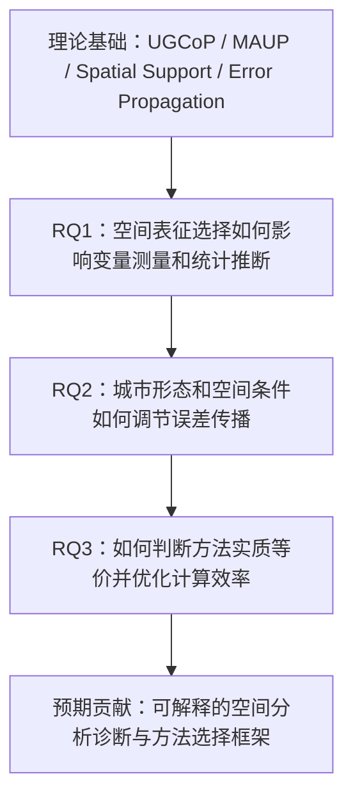

/# 文献
## 理论基础

### 01｜The Uncertain Geographic Context Problem
- **文章名称：** The Uncertain Geographic Context Problem
- **作者：** Mei-Po Kwan
- **年份：** 2012
- **DOI：** [10.1080/00045608.2012.687349](https://doi.org/10.1080/00045608.2012.687349)

**研究问题：** 同一个人的真实环境影响范围和作用时间并不等同于行政社区或研究者划定的邻域；这种错位会怎样影响结论？
**研究方法：** 概念与方法论论文；将 UGCoP 与 MAUP 区分，强调空间范围、暴露时刻和持续时间的未知。
**主要发现：** 情境单位的划分若偏离真实暴露情境，个体层面的邻域效应估计可能改变。
**研究局限：** 主要界定问题，不提供一个通用的真实邻域识别算法或因果估计保证。
**研究启发：** 先阐明因果机制与个体活动情境，再进行空间测量；区分“边界改变”与“实际暴露改变”。

---

### 02｜The Modifiable Areal Unit Problem in Multivariate Statistical Analysis
- **文章名称：** The Modifiable Areal Unit Problem in Multivariate Statistical Analysis
- **作者：** A. Stewart Fotheringham; David W. S. Wong
- **年份：** 1991
- **DOI：** [10.1068/a231025](https://doi.org/10.1068/a231025)

**研究问题：** 尺度与分区系统变化是否只影响地图展示，还是会改变多元回归的参数与推断？
**研究方法：** 比较多元线性回归和 Logit 回归在不同聚合尺度和分区方式下的参数估计。
**主要发现：** 多变量统计对 MAUP 的响应复杂且难以预先预测，参数和结论可能随尺度与分区改变。
**研究局限：** 证明敏感性本身已有先例；不能简单由某一尺度认定真实机制。
**研究启发：** 同时区分 scale effect 与 zoning effect；设置显著性、系数符号、效应量的稳健性指标。

---

### 03｜Error Propagation in Environmental Modelling with GIS
- **文章名称：** Error Propagation in Environmental Modelling with GIS
- **作者：** Gerard B. M. Heuvelink
- **年份：** 1998
- **DOI：** [10.4324/9780203016114](https://doi.org/10.4324/9780203016114)（电子书版本）
- **文献类型：** 学术专著

**研究问题：** 输入空间属性存在位置、测量与分类误差时，GIS 运算如何传播或放大这些误差？
**研究方法：** 建立输入误差模型；讨论局部 GIS 操作的误差传播、全局操作与多维随机模拟。
**主要发现：** 将GIS分析结果视为带有不确定性的计算结果，提供误差建模和传播的框架。
**研究局限：** 这是方法论专著，不能仅由书目直接推断其对特定城市邻域回归的实证结论。
**研究启发：** 建立“空间边界选择→暴露指标→回归系数→统计结论”的传播分析链，模拟已知真值进行诊断。

**出版社/书目入口：** https://www.routledge.com/Error-Propagation-in-Environmental-Modelling-with-GIS/Heuvelink/p/book/9780429215094

---

### 04｜Combining Incompatible Spatial Data
- **文章名称：** Combining Incompatible Spatial Data
- **作者：** Carol A. Gotway; Linda J. Young
- **年份：** 2002
- **DOI：** [10.1198/016214502760047140](https://doi.org/10.1198/016214502760047140)

**研究问题：** 点、网格、街区等不同空间支撑上的变量如何整合，且不扭曲后续统计推断？
**研究方法：** 综述空间数据不对齐、change of support、空间尺度与数据融合的统计方法。
**主要发现：** 不同数据分辨率与空间支撑的整合涉及结构性统计问题，不仅是 GIS 的数据叠加。
**研究局限：** 属于综述，不是某一个空间缓冲区模型的直接因果评估。
**研究启发：** 明确原始数据支撑、环境测量支撑和分析单元；不要把分辨率变化混同于情境范围变化。

---

### 05｜Comparing Effects of Euclidean Buffers and Network Buffers on Associations between Built Environment and Transport Walking: The Multi-Ethnic Study of Atherosclerosis
- **文章名称：** Comparing Effects of Euclidean Buffers and Network Buffers on Associations between Built Environment and Transport Walking: The Multi-Ethnic Study of Atherosclerosis
- **作者：** Jingjing Li; Adam Peterson; Amy H. Auchincloss; et al.
- **年份：** 2022
- **DOI：** [10.1186/s12942-022-00310-7](https://doi.org/10.1186/s12942-022-00310-7)

**研究问题：** 直线 Buffer 代替道路网络 Buffer 会怎样改变建成环境与交通步行的关联估计？
**研究方法：** 6个美国研究地点；模拟研究＋MESA多中心实证；对比0.25、1、5 km缓冲区和不同设施暴露。
**主要发现：** 在假定网络 Buffer 更接近真值的模拟条件下，欧氏Buffer的系数偏差约-80%至-20%；较大的5km尺度偏差更小；实证网络Buffer关联通常更强。
**研究局限：** 网络 Buffer 作为接近真实暴露的参照属于研究假设；数值不能无条件外推到任何城市或结果变量。
**研究启发：** 已存在“缓冲区选择→暴露测量→回归偏差”的示范；进一步需要不同误差来源的贡献分解和可迁移诊断。

---

### 06｜Effects of Buffer Size and Shape on Associations between the Built Environment and Energy Balance
- **文章名称：** Effects of Buffer Size and Shape on Associations between the Built Environment and Energy Balance
- **作者：** Peter James; David Berrigan; Jaime E. Hart; et al.
- **年份：** 2014
- **DOI：** [10.1016/j.healthplace.2014.02.003](https://doi.org/10.1016/j.healthplace.2014.02.003)

**研究问题：** Buffer半径与形状是否会改变步行、BMI等行为/健康关联？
**研究方法：** 不同大小与形状的邻域内计算路口密度、商业设施密度和计数等；使用线性回归进行敏感性检验。
**主要发现：** 回归效应大小与统计显著性随Buffer大小/形状而变，是既有研究结论。
**研究局限：** 不同结果并不证明哪一个空间定义代表真实暴露，也不自动表明存在因果效应。
**研究启发：** 把Buffer大小×形状作为预设的分析决策维度，但不要把“结果会变”当创新。

---

### 07｜Measuring the Unmeasurable: Models of Geographical Context
- **文章名称：** Measuring the Unmeasurable: Models of Geographical Context
- **作者：** A. Stewart Fotheringham; Ziqi Li
- **年份：** 2023
- **DOI：** [10.1080/24694452.2023.2227690](https://doi.org/10.1080/24694452.2023.2227690)

**研究问题：** 地理情境如何通过不可直接观测的地方特征和空间异质性影响行为关系？
**研究方法：** 区分 intrinsic contextual effects 与 behavioral contextual effects；通过蒙特卡洛模拟与2020年美国总统大选案例对比SEM、MLM、MGWR。
**主要发现：** 三种模型对内在地理情境效应呈现相近的空间格局；所考察设置中MGWR具有更好的估计精度。
**研究局限：** 研究条件下的性能优势不等于 MGWR 普遍最优；空间模型仍依赖规范设定和数据生成过程。
**研究启发：** 不能仅改变Buffer还保持模型错误设定；研究设计中应分别检验情境测量与统计模型设定。

---

### 08｜Increasing Transparency Through a Multiverse Analysis
- **文章名称：** Increasing Transparency Through a Multiverse Analysis
- **作者：** Sara Steegen; Francis Tuerlinckx; Andrew Gelman; Wolf Vanpaemel
- **年份：** 2016
- **DOI：** [10.1177/1745691616658637](https://doi.org/10.1177/1745691616658637)

**研究问题：** 研究者的数据筛选、转换、编码等合理决定会如何影响结果的稳定性？
**研究方法：** 提出 multiverse analysis，遍历事先界定的多种合理数据处理路径，系统展示结果分布。
**主要发现：** 单一处理方案可能隐藏研究结论的脆弱性；多宇宙分析可识别哪些选择最影响结论。
**研究局限：** 原研究重点是一般数据处理自由度，并非专为空间情境而设计；“全部组合”也可能计算不可行。
**研究启发：** 把事先合理的空间情境组合变成空间 multiverse；同时避免事后挑选显著结果。

---

## 空间表征、障碍与研究设计

### 09｜Quantifying the Relationships between Network Distance and Straight-Line Distance: Applications in Spatial Bias Correction
- **文章名称：** Quantifying the Relationships between Network Distance and Straight-Line Distance: Applications in Spatial Bias Correction
- **作者：** Xinyue Chen; Yimin Chen
- **年份：** 2021
- **DOI：** [10.1080/19475683.2021.1966503](https://doi.org/10.1080/19475683.2021.1966503)

**研究问题：** 欧氏距离与网络距离的差异怎样随城市结构、路程尺度而变化？
**研究方法：** 25座中国城市；DI=网络距离/直线距离；函数数据分析研究随距离变化的绕行模式；以K函数作偏差校正演示。
**主要发现：** 样本城市平均DI约1.324；城市内短距离出行通常绕行更明显；基于DI可改善欧氏距离K函数结果。
**研究局限：** DI反映距离关系，不等同于某项特定环境变量的暴露偏差或回归系数偏差。
**研究启发：** 将绕行指数、网络连通度等作为空间情境误差机制的解释变量。

---

### 10｜Missing Links: Quantifying Barrier Effects of Transport Infrastructure on Local Accessibility
- **文章名称：** Missing Links: Quantifying Barrier Effects of Transport Infrastructure on Local Accessibility
- **作者：** Job van Eldijk; Jorge Gil; Natalia Kuska; Rashmita Sisinty Patro
- **年份：** 2020
- **DOI：** [10.1016/j.trd.2020.102410](https://doi.org/10.1016/j.trd.2020.102410)

**研究问题：** 交通基础设施既提供跨区域连接，又可能在局地构成穿越障碍，如何测量后者？
**研究方法：** 提出四类局地可达性指标量化交通基础设施的屏障效应，并作案例展示。
**主要发现：** 同一基础设施对不同地点的局地可达性影响存在差异，可以量化并在空间上识别。
**研究局限：** 可达性屏障指标不自动等于邻域定义的推断误差，需要额外统计联系。
**研究启发：** 构造道路/河流/铁道屏障指标，解释直线与网络邻域何时分歧最大。

---

### 11｜Reducing the Uncertainty Induced by Spatial Aggregation in Accessibility and Spatial Interaction Applications
- **文章名称：** Reducing the Uncertainty Induced by Spatial Aggregation in Accessibility and Spatial Interaction Applications
- **作者：** Marcin Stępniak; Chris Jacobs-Crisioni
- **年份：** 2017
- **DOI：** [10.1016/j.jtrangeo.2017.04.001](https://doi.org/10.1016/j.jtrangeo.2017.04.001)

**研究问题：** 区域聚合与区内出行时间近似如何影响可达性和空间交互结果？
**研究方法：** 细粒度点间出行时间矩阵；计算交互加权出行时间；改进区内时间估计，比较人口加权与地理质心。
**主要发现：** 所提出的区内时间估计方法对空间聚合更不敏感；建议使用人口加权质心改善区际计算。
**研究局限：** 解决重点是可达性/交通时间的聚合误差，而非所有类型统计回归的误差。
**研究启发：** 针对面域聚合中的质心选择、区内距离和人口分布建立单独敏感性层。

---

### 12｜Capturing Exposure in Environmental Health Research: Challenges and Opportunities of Different Activity Space Models
- **文章名称：** Capturing Exposure in Environmental Health Research: Challenges and Opportunities of Different Activity Space Models
- **作者：** Tiina E. Laatikainen; Kamyar Hasanzadeh; Marketta Kyttä
- **年份：** 2018
- **DOI：** [10.1186/s12942-018-0149-5](https://doi.org/10.1186/s12942-018-0149-5)

**研究问题：** 居住地邻域与个体活动空间的不同定义如何改变建成环境与幸福感的关联？
**研究方法：** 芬兰赫尔辛基地区844名较年长受访者；行政单元、500m居住缓冲区、home range、个体化居住暴露四种模型。
**主要发现：** 四种空间定义得出的关联不同；绿地与健康的正相关只出现在个体化居住暴露模型；步行性和慢行道路与幸福感的相关性仅出现在home range模型。
**研究局限：** 不同模型揭示不同层面的情境，并不能仅凭统计显著性判定真值。
**研究启发：** 将日常活动空间作为机制参照或敏感性对照，承认住宅邻域不一定是唯一相关情境。

---

### 13｜Methodological Guidance for Selecting Buffers in Greenspace–Health Studies
- **文章名称：** Methodological Guidance for Selecting Buffers in Greenspace–Health Studies
- **作者：** Mohammad Javad Zare Sakhvidi; Matthew H. E. M. Browning; Karl Samuelsson; et al.
- **年份：** 2025
- **DOI：** [10.1016/j.lanplh.2025.101370](https://doi.org/10.1016/j.lanplh.2025.101370)

**研究问题：** 怎样选择具有机制依据、可复核、可比较的Buffer类型与半径？
**研究方法：** 跨学科专家组的Personal View/方法指导；梳理健康机制、人群、情境、数据质量等决定因素。
**主要发现：** 建议先依据机制选择Buffer类型，再确定尺度范围；可行时优先活动空间；报告多个尺度的敏感性；不建议仅凭R²/AIC寻找最优Buffer。
**研究局限：** 指南不是证明某一种Buffer普适优越的随机实验；其他研究领域应用需重新论证机制。
**研究启发：** 预注册合理的空间定义集合和解释依据；把“模型拟合最好”与“空间情境最恰当”分离。

---

### 14｜Modelling Spatial Heterogeneity in Exposure Buffers and Risk: A Hierarchical Bayesian Approach
- **文章名称：** Modelling Spatial Heterogeneity in Exposure Buffers and Risk: A Hierarchical Bayesian Approach
- **作者：** Saskia Comess; Daniel E. Ho; Joshua L. Warren
- **年份：** 2026
- **DOI：** [10.1093/jrsssc/qlag020](https://doi.org/10.1093/jrsssc/qlag020)

**研究问题：** 真正起作用的暴露半径未知且随地区变化，如何同时估计半径与暴露效应？
**研究方法：** 层次贝叶斯空间变化缓冲区半径(SVBR)与空间变点建模；模拟＋马达加斯加产前医疗服务案例；R包EpiBuffer。
**主要发现：** 在其模拟设置下改善关键参数估计/推断；实证显示医疗设施邻近性与产检利用相关且关系随空间而变化。
**研究局限：** 依赖贝叶斯层次模型与应用假设；已覆盖“自适应半径”这一构想，不能重复以此作为独创点。
**研究启发：** 如研究新方法，应考虑多种空间误差的交互、可解释诊断和外部验证，而不只估计变化半径。

---

## 进阶理论与扩展

### 15｜The Modifiable Areal Unit Problem
- **文章名称：** The Modifiable Areal Unit Problem
- **作者：** Stan Openshaw
- **年份：** 1983
- **DOI：** 未查到可确认的原始专著 DOI（ISBN：0860941345）
- **文献类型：** 学术专著

**研究问题：** 分析单元可人为调整为何是地理统计的基本问题？
**研究方法：** 经典概念性专著（Concepts and Techniques in Modern Geography，约40页）。
**主要发现：** 为尺度效应和分区效应的讨论提供经典理论源头。
**研究局限：** 此处只核实书目与领域地位，具体章节例证需获取原书后精读。
**研究启发：** 用于理论谱系，不作为算法创新证据；与1991年多元统计扩展配合阅读。

**书目入口：** https://books.google.com/books/about/The_Modifiable_Areal_Unit_Problem.html?id=oETj0AEACAAJ

---

### 16｜How GIS Can Help Address the Uncertain Geographic Context Problem in Social Science Research
- **文章名称：** How GIS Can Help Address the Uncertain Geographic Context Problem in Social Science Research
- **作者：** Mei-Po Kwan
- **年份：** 2012
- **DOI：** [10.1080/19475683.2012.727867](https://doi.org/10.1080/19475683.2012.727867)

**研究问题：** 如何用GIS与轨迹等信息更好地近似个体真实的时空情境？
**研究方法：** 讨论时空暴露情境的构建、机制概念模型、GPS/GIS 动态个体化测量及方法挑战。
**主要发现：** 仅用住宅行政边界会忽视跨区活动与时间变化；轨迹及个体化测量可缓解UGCoP。
**研究局限：** GPS记录有抽样、隐私、时间覆盖和计算成本问题，也无法直接证明因果。
**研究启发：** 研究需要清楚界定“可观测活动空间”和“因果相关情境”，两者不必相等。

---

### 17｜The Neighborhood Effect Averaging Problem (NEAP): An Elusive Confounder of the Neighborhood Effect
- **文章名称：** The Neighborhood Effect Averaging Problem (NEAP): An Elusive Confounder of the Neighborhood Effect
- **作者：** Mei-Po Kwan
- **年份：** 2018
- **DOI：** [10.3390/ijerph15091841](https://doi.org/10.3390/ijerph15091841)

**研究问题：** 忽略日常出行引入的非居住地暴露，会使邻域效应估计产生什么系统性问题？
**研究方法：** 提出 NEAP 理论并讨论相关经验研究；聚焦流动相关环境暴露。
**主要发现：** 居住地暴露差异可能因日常移动而趋于平均，从而使只依据住宅推断的邻域效应出现偏离。
**研究局限：** 偏差方向依赖流动、暴露分布及人群；不能将“平均化”强行套用于全部指标。
**研究启发：** 考虑通勤、活动链和非居住地暴露；必要时检验日常流动强度与情境敏感性的交互。

---

### 18｜Inference and Analysis across Spatial Supports in the Big Data Era: Uncertain Point Observations and Geographic Contexts
- **文章名称：** Inference and Analysis across Spatial Supports in the Big Data Era: Uncertain Point Observations and Geographic Contexts
- **作者：** Colin Robertson; Rob Feick
- **年份：** 2018
- **DOI：** [10.1111/tgis.12321](https://doi.org/10.1111/tgis.12321)

**研究问题：** 点观测不确定性与地理情境不确定性如何在个体-区域连接中产生不同推断问题？
**研究方法：** 提出UGCoP与UPOP的区分和空间支撑问题类型；结合地理社交数据案例。
**主要发现：** 错误的点位采样/定位和情境匹配都可能造成不同空间统计结论；不是单纯的MAUP。
**研究局限：** 从观测点到区域推断时还存在代表性与采样偏差，不能仅靠更精细Buffer消除。
**研究启发：** 对误差源分层：点位置误差、样本偏差、空间支撑不一致、情境定义误差。

---

### 19｜Context and Uncertainty in Geography and GIScience: Advances in Theory, Method, and Practice
- **文章名称：** Context and Uncertainty in Geography and GIScience: Advances in Theory, Method, and Practice
- **作者：** Mei-Po Kwan; Tim Schwanen
- **年份：** 2018
- **DOI：** [10.1080/24694452.2018.1457910](https://doi.org/10.1080/24694452.2018.1457910)

**研究问题：** 地理情境与不确定性问题在GIScience中有哪些跨领域研究线索？
**研究方法：** 2017 AAG主题论坛6篇文章的导言/背景综述，不是独立的大样本实验。
**主要发现：** 提供情境、不确定性与GIScience理论和方法发展间的整体研究脉络。
**研究局限：** 不能把导言当作已经实证验证具体方法性能的论文。
**研究启发：** 用于搭建综述框架与扩大检索词；随后回到具体方法论文寻找操作证据。

---

## 空间关系与数据驱动方法

### 20｜Beyond Geographical Proximity: A Graph-Enhanced Spatial Weight Matrix Integrating Attributes and Spatial Interactions
- **文章名称：** Beyond Geographical Proximity: A Graph-Enhanced Spatial Weight Matrix Integrating Attributes and Spatial Interactions
- **作者：** Qiuping Li; Yan Wei; Yang Zhou; Suhong Zhou; Jing Yao; Li Zhuo
- **年份：** 2026
- **DOI：** [10.1080/13658816.2026.2727960](https://doi.org/10.1080/13658816.2026.2727960)

**研究问题：** 邻接/距离不足以表示属性相似与真实空间交互时，空间权重如何扩展？
**研究方法：** 图卷积网络表示属性和交互信息，多层感知机与地理距离融合生成GSWM；置于GWR中；模拟＋广州城市活力案例。
**主要发现：** 所评估设置中GSWM-GWR优于比较的空间加权方式，并可考察属性与交互信息对局部估计的影响。
**研究局限：** 核心属于数据驱动空间权重学习，结果不等同于缓冲区情境定义优劣；不必沿用GNN作为主线。
**研究启发：** 作为邻域“空间关系可多维定义”的证据，主研究仍聚焦可解释的情境测量不确定性。

---

### 一、研究主线

| 研究主线 | 关联文献 | 核心问题 |
| --- | --- | --- |
| UGCoP与真实地理情境 | 01、12、16、17、19 | 如何界定实际产生影响的空间和时间情境？ |
| MAUP与空间支撑 | 02、04、11、15、18 | 尺度、分区及数据支撑变化如何影响统计推断？ |
| 空间测量误差与传播 | 03、05、06、09、10 | 空间表征差异如何转化为变量测量和统计结果差异？ |
| 方法选择与稳健性 | 07、08、13、14 | 如何评价多种合理分析方法，判断结果是否稳定？ |
| 数据驱动空间关系建模 | 20 | 能否结合多维空间关系改善模型表现？ |

### 二、拟议研究问题

**RQ1｜误差传播机制**

不同空间表征选择如何影响地理变量的构建？这些测量差异通过哪些机制传播到回归系数、显著性和其他统计推断结果？

**RQ2｜城市空间条件与交互作用**

城市形态、道路连通性、交通障碍、空间异质性和聚合方式如何共同决定空间分析结果的敏感性？哪些条件会放大、抑制或抵消空间表征误差？

**RQ3｜方法适用性与计算效率**

在什么条件下不同空间分析方法的结果可视为实质等价？是否能够依据数据特征和城市形态，选择在误差可接受范围内计算成本更低的方法？

### 三、整体研究路线

### 四、现有研究与潜在增量

UGCoP、MAUP、缓冲区尺度与形状敏感性、网络缓冲区比较以及自适应缓冲区方法均已有先前研究。因此，不能简单地以“证明空间方法会影响结果”或“让不同位置采用不同半径”作为独立创新点。

更值得继续验证的是：**（1）不同误差源的可解释传播机制；（2）城市空间结构对误差的调节作用；（3）有明确误差容忍阈值的空间方法选择与效率优化。**
