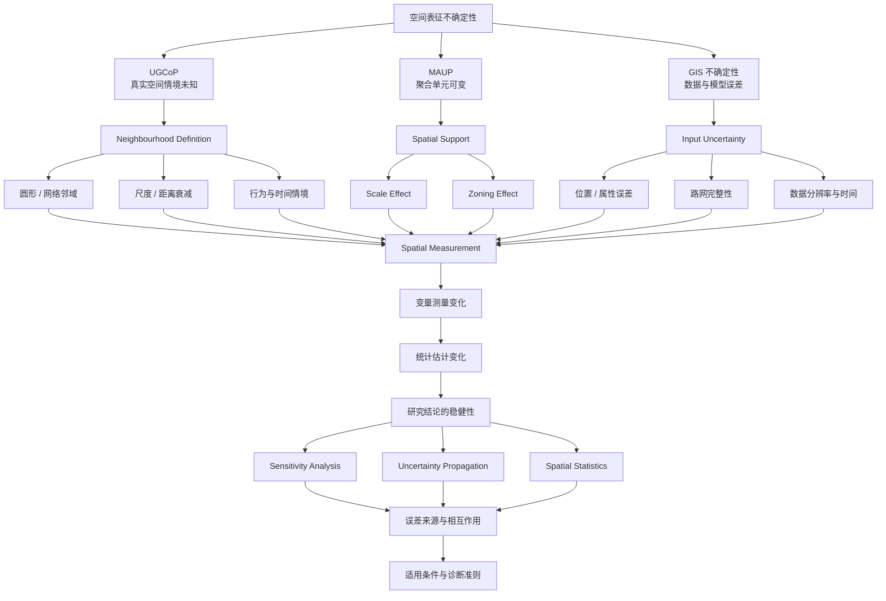

Existing research has demonstrated that geographical context definitions and spatial aggregation choices can influence analytical results. However, I am particularly interested in understanding why these effects sometimes become substantial and sometimes remain negligible.

I would like to investigate the mechanisms through which spatial representation uncertainty propagates into statistical inference, and identify the conditions under which alternative representations yield sufficiently robust conclusions.

Form Identifying Uncertainty -> Explaining Its Consequences -> Evaluating Robustness

1.     Conduct a sensitivity analysis by combining UGCoP and MAUP

2.     When, why, and under what circumstances does spatial uncertainty affect statistical conclusions, and when can it be demonstrated that simple spatial representations are sufficiently robust in specific tasks?

# 研究知识图谱：UGCoP × MAUP × 空间误差传播

==🔴Spatial Representation Uncertainty and Its Propagation into Geographical Analysis（空间表征不确定性及其在地理分析中的传播）

## 一、三个核心理论的关系

UGCoP: 空间情境定义
我研究的地方，是否是实际发挥影响的地方？

MAUP: 空间单元划分
同一现象换一种聚合尺度或分区，结果会否改变？

Error Propagation: 误差与不确定性传播
前面空间定义的变化，如何影响后续测量和推断？

共同研究主题：Spatial Representation Uncertainty

### 1. UGCoP — Uncertain Geographic Context Problem

由 Mei-Po Kwan 在 2012 年系统提出。

它关注的是：

\[ \text{Assumed Geographic Context} \neq \text{True Relevant Context} \]

假设你研究地铁站周围的商业环境。

- 800 m 圆形 Buffer 定义了一种 context。
    
- 800 m 网络可达范围定义了另一种 context。
    
- 居民真正使用的商业设施可能又构成第三种 context。
    

UGCoP 强调，真正产生情境影响的空间范围及作用时间可能是未知的，因此研究者的空间界定可能改变统计推断。它不只是一个缓冲区形状问题。

### 2. MAUP — Modifiable Areal Unit Problem

这是空间数据聚合带来的问题，主要包括：

- Scale effect：100 m 网格、500 m 网格、行政区等不同聚合尺度。
- Zoning effect：即使尺度相近，单元边界的重新划分也可能改变结果。

Fotheringham & Wong (1991) 已经证明，多元统计分析的参数估计可能对空间尺度和分区方式非常敏感。

### 3. Error and Uncertainty Propagation — 误差与不确定性传播

这一条研究的是整个分析流程。

\[ \boxed{ \text{Spatial Definition} \longrightarrow \text{Data Measurement} \longrightarrow \text{Statistical Estimation} \longrightarrow \text{Research Conclusion} } \]

假如某个邻域界定改变了 30%，你真正需要回答的不是“30% 是否算严重”，而是：

这种改变最终有没有影响研究结论？如果有，影响经过哪些步骤产生？

Heuvelink 的经典 GIS 不确定性传播研究，就是这条方法学路线的重要基础。

1st Edition -

### Spatial Representation Uncertainty — 知识关系总图

六个知识层级：理论 → 空间表征 → 误差来源 → 误差传播 → 分析验证 → 方法贡献

这张图有三个你需要牢牢记住的逻辑关系：

- UGCoP → Context specification：研究者如何定义真正相关的空间范围。
    
- MAUP → Spatial support / aggregation：数据如何被组织、聚合到不同空间单元。
    
- Error propagation → Downstream consequences：这些选择产生的差异如何进入变量、模型与结论。
    

在空间统计学中，还有一个非常重要的桥接概念：Change of Support Problem（COSP，空间支撑转换问题）。

它研究不同分辨率、不同空间支撑的数据如何进行转换和整合。Gotway & Young (2002) 的 Combining Incompatible Spatial Data 是这条知识线的代表性论文。

tandfonline.com

## 三、把知识图谱拆成六个学习模块

下面的表可以直接作为你未来文献管理、知识笔记和学习安排的目录。

|模块|核心知识节点|你必须回答的问题|
|---|---|---|
|A. 空间情境理论|UGCoP、Geographic Context、Neighbourhood Effects、Activity Space、NEAP|什么才是与研究问题相关的空间？|
|B. 空间单元理论|MAUP、Scale Effect、Zoning Effect、COSP、Ecological Fallacy|空间单元变化为何导致统计结果变化？|
|C. 空间表征方法|Euclidean Buffer、Network Catchment、Isochrone、Spatial Weights、Distance Decay|如何把抽象的 neighbourhood 变成可计算对象？|
|D. 空间数据不确定性|Positional Error、Attribute Error、Topology Error、Resolution、Missing Data|输入数据的错误如何影响结果？|
|E. 误差与敏感性传播|Error Propagation、Sensitivity Analysis、Monte Carlo、Variance Decomposition、Interaction Effects|哪些前期变化会被放大，哪些会被消除？|
|F. 统计推断与稳健性|OLS、Spatial Autocorrelation、Spatial Regression、Confidence Intervals、Robustness、Specification Curve|最终研究结论是否依赖某一种空间定义？|

其中 A、B、E 是理论主干，C、D 是 GIS 技术基础，F 是把研究提升到统计推断层面的关键。

## 四、最重要的研究核心：误差传播链

我认为这应该是你花最多精力建立知识体系的部分。

### 4.1 第一阶段：空间表征的不确定性

首先，你要理解什么是 Spatial Representation Choice。

它至少有两个可以分别改变的维度。

|维度|可以改变什么|对应理论|
|---|---|---|
|Context definition|Buffer 半径、形状、网络距离、时间阈值、距离衰减|UGCoP|
|Spatial support|网格大小、网格起点、行政分区、聚合单元|MAUP / COSP|

例如，你研究地铁站周围的 POI density，可以保持站点位置和城市 POI 数据不变，只改变 neighbourhood definition。

或者固定 neighbourhood definition，但把最终模型的分析单元由 250 m 网格改为 500 m 网格。

这两个实验在理论上研究的是不同的问题。

特别注意：空间邻域不规则，不代表一定发生了 MAUP。 如果你只是围绕同一批地点把圆形 buffer 换成网络服务区，而没有改变数据聚合单元，主要面对的是 neighbourhood/context specification，而不是典型的 MAUP。

### 4.2 第二阶段：测量差异的产生

假设：

\[ B_i^{(c,r)} \]

表示位置 \(i\) 在邻域类型 \(c\)、尺度 \(r\) 下的空间范围。

假设：

\[ Z(s) \]

表示某个空间属性，例如商业 POI 分布、人口密度或建筑物密度。

那么该位置的测量值是：

\[ X_i^{(c,r)} = T\big(Z(s),B_i^{(c,r)}\big) \]

其中 \(T\) 是 GIS 空间提取与汇总操作，例如 Count、Sum、Mean、Density。

你可以计算：

\[ \Delta X_i = X_i^{(Euclidean)} - X_i^{(Network)} \]

但要注意：这里的 \(\Delta X\) 严格来说是方法间测量差异，不一定是真实测量误差。

#### 一张特别有价值的关系表

|空间边界差异|属性空间分布|测量差异可能怎样|
|---|---|---|
|小|均匀|通常较小|
|大|均匀|不一定大|
|小|高度集聚|可能很大|
|大|高度集聚|取决于集聚发生在何处|

上述是理论上可能出现的情况，并不是已经确认的经验规律。

这里有一个很有潜力的研究切入点：

Neighbourhood discrepancy 如何与 spatial heterogeneity 相互作用，共同决定 measurement sensitivity？

也就是说，你不仅研究 Buffer 与 Network 的差异，还研究城市空间属性本身的分布模式如何改变这种差异的后果。

### 4.3 第三阶段：统计推断中的传播

假设你有：

\[ Y_i=\beta_0+\beta_1X_i+\epsilon_i \]

改变 neighbourhood 后：

\[ X_i^A\rightarrow X_i^B \]

那么会得到两组估计：

\[ \hat{\beta}^{A},\quad\hat{\beta}^{B} \]

你真正想比较的可能是：

\[ \Delta\hat{\beta} = \hat{\beta}^{A} - \hat{\beta}^{B} \]

再继续看：

\[ \Delta CI,\quad \Delta R^2,\quad \Delta AIC \]

以及结果的实际解释有没有变化。

尤其重要的是：

\[ \boxed{ \text{Large Spatial Difference} \not\Rightarrow \text{Large Inferential Difference} } \]

已有 Li et al. (2022) 在六个研究地区比较了不同 buffer 定义对 built-environment–walking 关系估计的影响，并通过模拟研究了相对偏差。需要注意，他们的模拟把 network-based exposure 作为较接近真实暴露的假设，而不是在实证中直接观察到了绝对正确的 context。

Springer Nature Link

### 4.4 第四阶段：多种不确定性的共同作用

这一步会真正把你的研究从 Buffer 比较扩展为 UGCoP × MAUP × Error Propagation。

假设：

\[ \hat\theta = f(C,U,Q,M) \]

其中：

- \(C\)：Context definition，空间邻域界定。
    
- \(U\)：Spatial support，空间单元及聚合方案。
    
- \(Q\)：Data quality，输入数据质量。
    
- \(M\)：Statistical model，统计模型设定。
    
- \(\hat\theta\)：最终估计的系数、效应或其他研究结果。
    

那么研究不只是逐个改变变量，而可以考察：

\[ \Delta\hat\theta_C \]

\[ \Delta\hat\theta_U \]

以及：

\[ \Delta\hat\theta_{C\times U} \]

最后一项尤其有价值，代表：

> Neighbourhood definition 与 Spatial aggregation 是否存在交互作用？

例如，一个 800 m Euclidean buffer 在 100 m 网格下和 network catchment 得到相似的模型结果，但在 1 km 网格下，两者差异可能被放大、缩小或改变方向。

这种情形应该由实验来判断，而不是提前假设。

## 五、需要重点掌握的数学与统计方法

这部分我按照学习优先级排序，不涉及机器学习。

|优先级|方法|在你的研究中有什么用|
|---|---|---|
|1|Descriptive Statistics|建立不同空间定义下的基础分布|
|2|Spatial Overlap / Jaccard|比较邻域的几何差异|
|3|Sensitivity Analysis|研究结果对各类设定的敏感程度|
|4|Monte Carlo Simulation|在已知真实生成机制下研究误差传播|
|5|Regression Diagnostics|检验系数、残差与估计稳定性|
|6|Spatial Autocorrelation|判断空间相关性是否影响统计推断|
|7|Spatial Regression|在存在空间依赖时进行稳健分析|
|8|Factorial Experimental Design|区分 UGCoP、MAUP 和数据质量的独立与交互影响|
|9|Variance Decomposition / ANOVA|研究不同设定对结果变异的相对贡献|
|10|Bootstrap / Confidence Intervals|量化统计估计的不确定性|
|11|Segmented Regression|探索敏感性是否存在明显变化区间|
|12|Spatially Varying Coefficient Models|作为进阶方法研究空间异质性|

其中我建议你特别增加两个以前没有重点讨论的方法。

### 5.1 Monte Carlo Simulation

这是把你的研究从简单比较推进到误差传播研究的重要方法。

在真实城市数据中，你往往不知道哪个邻域定义是正确的。

但在模拟实验里，可以先定义一个已知的空间生成过程：

\[ Y=\beta_0+\beta_1X^{true}+\epsilon \]

然后通过不同的 neighbourhood definitions 重新测量 \(X\)，观察：

\[ \hat\beta-\beta^{true} \]

这样你可以真正计算估计偏差、均方误差和区间覆盖率。

模拟实验用于识别机制，真实城市数据用于验证现象是否具有现实相关性。

这不需要 ML，而且比只用实证数据宣布某个方法“更准确”严谨得多。Heuvelink 的 GIS 误差传播著作也系统介绍了模拟方法处理空间分析中的不确定性。

1st Edition -

### 5.2 Multiverse Analysis

这是我认为值得你特别增加的一条知识线。

Steegen et al. (2016) 提出了 Multiverse Analysis：不要只报告研究者选择的一条数据处理路径，而是系统呈现多种合理分析决策所产生的结果，以检验结论的稳健性。

journals.sagepub.com

在你的研究中，可以把它转化为：

### Spatial Analysis Multiverse

Context

Circular

Network

Distance decay

Scale

400 m

800 m

1200 m

Spatial unit

250 m grid

500 m grid

Shifted grid

多个合理分析设定

结果分布 / 敏感性曲线 / 稳健性评价

这里是从 Multiverse Analysis 推导出来的研究设计，不是要求所有组合都必须执行。组合应当在理论上合理，且保持必要的可比性。

这可能比单纯设置一组 Buffer Radius 更适合你的研究目标。

## 六、如何把整个知识体系变成一项研究

这里我建议设计为三个彼此关联、但能够相对独立回答问题的研究阶段。

## 01

理论/测量

Spatial Representation and Measurement Sensitivity

探究 neighbourhood definition 和 spatial aggregation 如何独立或共同改变城市空间变量的测量结果。

主要理论：UGCoP + MAUP + COSP。

## 02

统计/机制

Propagation of Spatial Representation Uncertainty

检验空间定义和输入数据的不确定性，如何通过变量构建与统计分析传递到最终研究结论。

主要方法：Sensitivity Analysis + Simulation + Spatial Statistics。

## 03

综合/应用

Context-Dependent Robustness and Diagnostic Criteria

研究哪些城市空间条件、尺度和分析目的，会导致某种空间定义对后续结论产生不可忽略的影响。

主要方法：Factorial Analysis + Robustness Analysis + Interpretable Statistical Rules。

### 我建议的核心 Research Questions

RQ1 — Representation

How do geographic context delineation and spatial aggregation independently and jointly affect the measurement of urban spatial characteristics?

RQ2 — Propagation

How does uncertainty arising from spatial representation propagate through spatial measurement and statistical inference?

RQ3 — Conditions

Under what spatial, morphological and analytical conditions do alternative geographic representations lead to materially different research conclusions?

RQ4 — Diagnostic implications

Can robust and interpretable criteria be established to guide the selection and evaluation of spatial representations in urban analysis?

我把 RQ4 作为一个可能的应用目标，而不是目前一定要完成的理论承诺。尤其不应在研究开始前预设一定存在统一数值阈值。

第一梯队 · 理论基础与直接前序研究

|顺序|文献|知识节点|
|---|---|---|
|1|[Kwan (2012) — The Uncertain Geographic Context Problem](https://doi.org/10.1080/00045608.2012.687349?utm_source=chatgpt.com)|UGCoP 的定义、空间与时间情境不确定性|
|2|[Fotheringham & Wong (1991) — The Modifiable Areal Unit Problem in Multivariate Statistical Analysis](https://doi.org/10.1068/A231025?utm_source=chatgpt.com)|MAUP 如何改变回归参数和统计结论|
|3|[Heuvelink (1998) — Error Propagation in Environmental Modelling with GIS](https://www.routledge.com/Error-Propagation-in-Environmental-Modelling-with-GIS/Heuvelink/p/book/9780429215094?utm_source=chatgpt.com)|GIS 误差传播的理论与模拟方法；这是专著|
|4|[Gotway & Young (2002) — Combining Incompatible Spatial Data](https://www.tandfonline.com/servlet/linkout?type=Scholix&url=https:%2F%2Fdx.doi.org%2F10.1198%252F016214502760047140&utm_source=chatgpt.com)|COSP 与不同空间支撑数据的整合|
|5|[Li et al. (2022) — Comparing Effects of Euclidean Buffers and Network Buffers](https://link.springer.com/article/10.1186/s12942-022-00310-7?utm_source=chatgpt.com)|邻域定义差异如何影响统计估计|
|6|[James et al. (2014) — Effects of Buffer Size and Shape on Associations between the Built Environment and Energy Balance](https://pmc.ncbi.nlm.nih.gov/articles/PMC4028172/?utm_source=chatgpt.com)|Buffer 尺度与形状敏感性|
|7|[Fotheringham & Li (2023) — Measuring the Unmeasurable: Models of Geographical Context](https://www.tandfonline.com/doi/full/10.1080/24694452.2023.2227690?utm_source=chatgpt.com)|地理情境、空间模型和不可直接测量的 contextual effects|
|8|[Steegen et al. (2016) — Increasing Transparency Through a Multiverse Analysis](https://journals.sagepub.com/doi/10.1177/1745691616658637?utm_source=chatgpt.com)|系统考察分析决策如何影响最终结论|

第 7 篇我尤其建议你重视。Fotheringham & Li (2023) 讨论了地理情境影响如何进入空间模型，并比较 Spatial Error Model、Multilevel Model 和 MGWR；它可以帮助你从空间测量转向空间统计推断。

tandfonline.com

第二梯队 · 空间表征、障碍和研究设计

|顺序|文献|知识节点|
|---|---|---|
|9|[Chen & Chen (2021) — Quantifying the Relationships between Network Distance and Straight-Line Distance](https://doi.org/10.1080/19475683.2021.1966503?utm_source=chatgpt.com)|Detour Index、尺度和城市间距离差异|
|10|[van Eldijk et al. (2020) — Missing Links: Quantifying Barrier Effects of Transport Infrastructure on Local Accessibility](https://www.sciencedirect.com/science/article/pii/S1361920920305976?utm_source=chatgpt.com)|物理障碍与网络可达性的量化|
|11|[Reducing the Uncertainty Induced by Spatial Aggregation in Accessibility and Spatial Interaction Applications (2017)](https://www.sciencedirect.com/science/article/pii/S0966692316305385?utm_source=chatgpt.com)|可达性计算中的 MAUP、区内距离与空间聚合|
|12|[Laatikainen et al. (2018) — Capturing Exposure in Environmental Health Research](https://link.springer.com/article/10.1186/s12942-018-0149-5?utm_source=chatgpt.com)|不同 activity-space 模型对测量与关联结果的影响|
|13|[Zare Sakhvidi et al. (2025) — Methodological Guidance for Selecting Buffers in Greenspace–Health Studies](https://doi.org/10.1016/j.lanplh.2025.101370?utm_source=chatgpt.com)|根据研究机制、数据、尺度和人群选择邻域|
|14|[Comess et al. (2026) — Modelling Spatial Heterogeneity in Exposure Buffers and Risk](https://academic.oup.com/jrsssc/advance-article-abstract/doi/10.1093/jrsssc/qlag020/8566157?utm_source=chatgpt.com)|空间变化的缓冲区半径与参数不确定性|

尤其要注意 2025 年的 buffer-selection guidance 已经明确提出，buffer 选择应由研究机制驱动，而不是寻找一个对所有研究都适用的半径。

The Lancet Planetary Health

第三梯队 · 进阶理论与潜在扩展

|文献|对应知识节点|
|---|---|
|[Openshaw (1983) — The Modifiable Areal Unit Problem](https://books.google.com/books/about/The_Modifiable_Areal_Unit_Problem.html?id=oETj0AEACAAJ&utm_source=chatgpt.com)|MAUP 的经典理论源头；专著|
|[Kwan (2012) — How GIS Can Help Address the Uncertain Geographic Context Problem in Social Science Research](https://www.tandfonline.com/doi/abs/10.1080/19475683.2012.727867?utm_source=chatgpt.com)|GIS 如何帮助处理 UGCoP|
|[Kwan (2018) — The Neighborhood Effect Averaging Problem](https://pubmed.ncbi.nlm.nih.gov/30150510/?utm_source=chatgpt.com)|Mobility、NEAP 与居住地暴露测量|
|[Robertson et al. (2018) — Inference and Analysis across Spatial Supports in the Big Data Era](https://onlinelibrary.wiley.com/doi/10.1111/tgis.12321?utm_source=chatgpt.com)|空间支撑、点数据不确定性与地理情境|
|[Context and Uncertainty in Geography and GIScience (2018)](https://www.tandfonline.com/doi/full/10.1080/24694452.2018.1457910?utm_source=chatgpt.com)|地理情境不确定性的综合理论背景|

### 一个可行的初始实验?

你可以这样组织 Research Gap：

已有研究：

> Previous studies have demonstrated that spatial context definitions and aggregation schemes can influence statistical results.

你的观察：

> However, I am particularly interested in understanding the propagation process itself, rather than only comparing the final outputs produced by different spatial definitions.

潜在空白：

> I would like to investigate whether we can systematically separate the effects of context delineation, spatial aggregation and data uncertainty, and identify the conditions under which these differences materially affect statistical inference.

注意使用 I would like to investigate whether...。

不要写成：

> No previous study has investigated the propagation of spatial uncertainty.

因为这种表述过于绝对，而且已有大量相关研究。

RQ1 · Measurement

How do alternative neighbourhood definitions and spatial aggregation schemes affect the measurement of urban spatial characteristics?

研究空间定义变化如何影响 POI density、land-use mix 等变量。

RQ2 · Propagation

How do these representation-induced differences propagate into statistical estimation and inference?

研究回归系数、标准误、模型表现和结论稳健性。

RQ3 · Conditions

Under what spatial and analytical conditions do these differences become consequential?

研究城市形态、网络结构、空间尺度与变量空间异质性的作用。

1. Controlled comparative experiments

保持研究问题、研究对象和数据源尽可能一致，分别改变邻域定义、聚合尺度及分区方案，从而识别不同因素的作用。

2. Monte Carlo simulation

在设定了已知空间生成机制的模拟实验中，研究 neighbourhood misspecification 如何影响估计偏差和统计推断。

3. Empirical case studies

利用一个或多个城市的数据，检查模拟发现的敏感性机制是否会出现在真实城市环境中。

|版块|内容|建议篇幅|
|---|---|---|
|Working Title|Spatial Representation Uncertainty and Its Propagation into Urban Spatial Analysis|1 行|
|Research Motivation|Euclidean buffer 与实际网络邻域差异，可能改变变量和推断|3–4 句|
|Theoretical Foundation|UGCoP、MAUP、Error/Uncertainty Propagation|3 句|
|Literature & Potential Gap|已有研究证明敏感性；尚需验证系统性的传播机制与条件|4–5 句|
|Research Questions|Measurement、Propagation、Conditions|3 个问题|
|Potential Methods|Comparative experiments、Monte Carlo、Spatial statistics|3 句|
|Expected Contribution|可解释的空间表征敏感性框架|2 句|

我建议只放四篇关键论文作为谈话锚点：

- Kwan (2012) — UGCoP
    
- Fotheringham & Wong (1991) — MAUP
    
- Li et al. (2022) — Euclidean vs Network Buffers and Regression
    
- Heuvelink (1998) — GIS Error Propagation

我认为下面这些研究必须进入你的 Literature Review。

|论文|已经解决的问题|对你的启示|
|---|---|---|
|Kwan (2012)|UGCoP：空间情境界定会影响统计推断|不能把发现邻域差异作为新贡献|
|Fotheringham & Wong (1991)|MAUP：尺度和分区变化会改变多变量统计结果|不能把尺度敏感性作为新发现|
|Li et al. (2022)|Euclidean/network buffer 差异如何造成回归估计偏差|已经涉及你设想的误差传播链|
|Duque et al. (2018)|S-maup：利用统计检验判断空间变量对 MAUP 的敏感程度|已经存在类似你想建立的诊断工具|
|Kedron et al. (2022)|用 Specification Curve 系统展示空间模型选择带来的不确定性|不同分析方案下的结论稳健性已有研究|
|Conceicao et al. (2026)|不同情境变量定义与空间尺度如何共同改变 neighbourhood effect estimates|直接涉及多种空间不确定性的交互|

### 一个与你的想法非常接近的先例：S-maup

Duque、Laniado 和 Polo 在 2018 年提出了一个非参数统计检验，判断空间变量对 MAUP 是否敏感，还通过模拟确定检验的临界值。

PLOS One

这实际上与你以前构想的：

> 输入空间数据 → 计算指标 → 判断当前分析方法是否可能存在问题

已经很接近。

不过，S-maup 主要针对空间聚合对变量分布的影响，不是直接判断 UGCoP 与 MAUP 如何共同影响下游回归结论。

### Conceicao et al. (2026)

The Problem of Uncertain Contextual Characteristic (PUCC): does it matter how contextual poverty is measured for the neighbourhood effect estimation?

这篇 2026 年发表的论文特别重要。

作者研究不同贫困指标的定义如何改变 neighbourhood effect estimates，还进一步比较了空间尺度和研究区域的影响。

他们发现，变量定义本身产生的估计差异可能比空间尺度变化更大，而且这些不确定性之间存在交互作用。

tandfonline.com

这意味着：

不能声称“过去没人同时研究不同空间不确定性及其对统计推断的影响”。

但这篇也提示了一个更深入的问题：

> 即使我们知道多种空间定义和变量构造方法都会影响结果，能否解释这些变化如何通过特定机制被放大、抑制或相互抵消？

这是我认为值得继续推进的地方。

重点重点重点：即使我们知道多种空间定义和变量构造方法都会影响结果，能否解释这些变化如何通过特定机制被放大、抑制或相互抵消？

## 二、我认为真正值得研究的 Gap 有四种

经过这次检索，我把可能的发展方向重新分成四条。它们不是同一个问题，创新性和难度也不同。

| 潜在 Gap                                   | 研究核心                     | 我的判断           |
| ---------------------------------------- | ------------------------ | -------------- |
| A. Uncertainty Propagation Mechanisms    | 为什么空间测量差异有时被放大、有时被抵消？    | 值得重点研究         |
| B. Interactions Between Uncertainties    | UGCoP 与 MAUP 的作用是否相互影响？  | 有价值，但已有直接先例    |
| C. Conditional Analytical Robustness     | 什么条件下不同空间定义产生的结果可视为实质等价？ | 我最推荐           |
| D. Decision-Oriented Spatial Diagnostics | 何时需要更复杂的空间分析，何时简单方法已足够？  | 应用价值高，适合作为后期成果 |