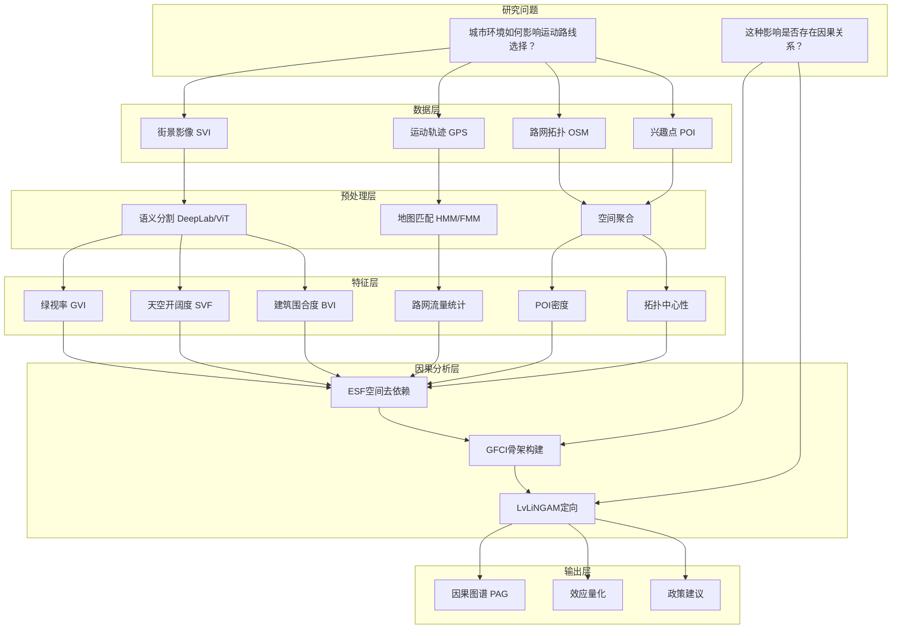
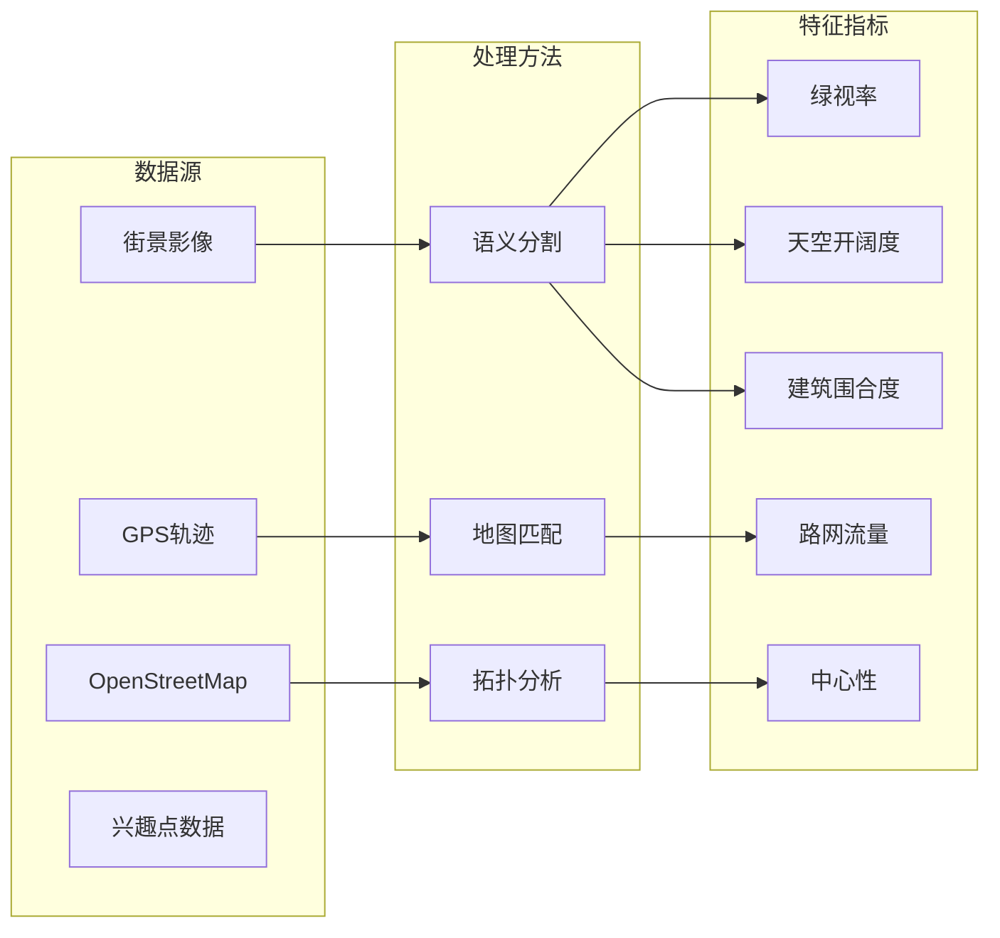
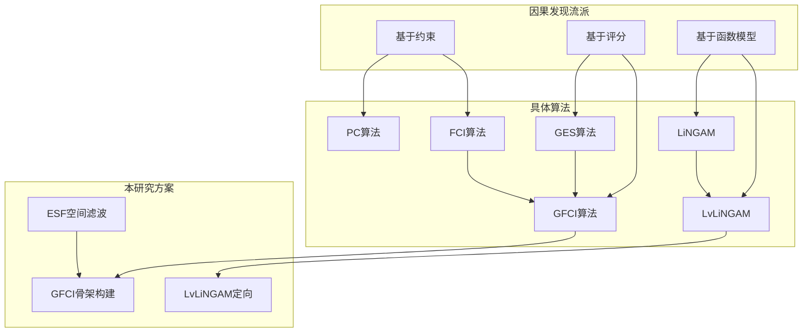
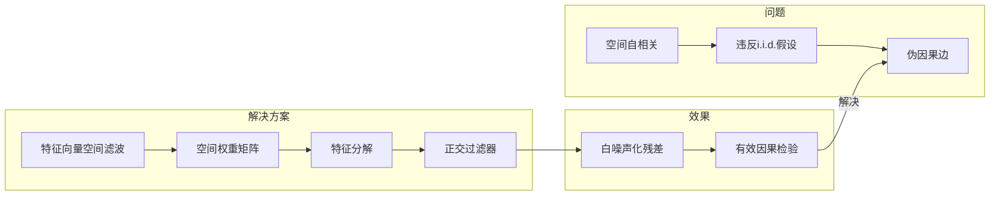
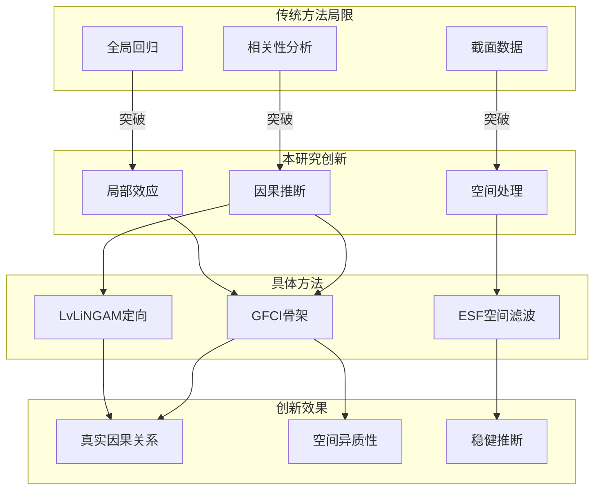

# 概念关系图

> 本文件展示研究中的核心概念及其相互关系，帮助理解研究框架的整体结构。

---

## 研究框架概念图

---

## 核心概念关系

### 1. 数据概念关系

### 2. 方法论概念关系

### 3. 空间自相关处理流程

---

## 概念定义速查

### 数据概念

| 概念 | 全称 | 说明 | 相关文件 |
|------|------|------|----------|
| SVI | Street View Imagery | 街景影像数据 | [[1. 街景环境与可持续出行_研究现状与创新点]] |
| GVI | Green View Index | 绿视率，植被像素占比 | [[5.1.城市环境与微观运动路线：基于多源空间数据与混合因果模型的路径选择机制研究]] |
| SVF | Sky View Factor | 天空开阔度，天空像素占比 | [[5.1.城市环境与微观运动路线：基于多源空间数据与混合因果模型的路径选择机制研究]] |
| BVI | Building View Index | 建筑围合度，建筑像素占比 | [[5.1.城市环境与微观运动路线：基于多源空间数据与混合因果模型的路径选择机制研究]] |
| OSM | OpenStreetMap | 开源地理空间数据平台 | [[4.开放数据来源]] |
| POI | Point of Interest | 兴趣点数据 | [[4.开放数据来源]] |

### 方法论概念

| 概念 | 全称 | 说明 | 相关文件 |
|------|------|------|----------|
| HMM | Hidden Markov Model | 隐马尔可夫模型 | [[5.3.解释：隐马尔可夫模型 (HMM) 快速地图匹配框架 (FMM)]] |
| FMM | Fast Map Matching | 快速地图匹配框架 | [[5.3.解释：隐马尔可夫模型 (HMM) 快速地图匹配框架 (FMM)]] |
| ESF | Eigenvector Spatial Filtering | 特征向量空间滤波 | [[5.1.城市环境与微观运动路线：基于多源空间数据与混合因果模型的路径选择机制研究]] |
| GFCI | Greedy Fast Causal Inference | 贪婪快速因果推断算法 | [[3.因果算法选择]] |
| LiNGAM | Linear Non-Gaussian Acyclic Model | 线性非高斯无环模型 | [[3.因果算法选择]] |
| PAG | Partial Ancestral Graph | 部分祖先图 | [[3.因果算法选择]] |

### 统计概念

| 概念 | 说明 | 相关文件 |
|------|------|----------|
| 空间自相关 | 地理数据中邻近区域相似性现象 | [[5.1.城市环境与微观运动路线：基于多源空间数据与混合因果模型的路径选择机制研究]] |
| 混杂偏误 | 未观测变量导致的因果推断偏差 | [[5.1.城市环境与微观运动路线：基于多源空间数据与混合因果模型的路径选择机制研究]] |
| 条件独立性 | 给定条件下变量间的独立性 | [[3.因果算法选择]] |
| 非高斯分布 | 不服从正态分布的数据特征 | [[3.因果算法选择]] |

---

## 研究创新点关系图

---

## 使用说明

1. **查看概念图**：
   - 在Obsidian中安装Mermaid插件可查看流程图
   - 或使用其他支持Mermaid的Markdown编辑器

2. **概念导航**：
   - 点击概念名称可跳转到相关文件
   - 使用Obsidian的图谱视图查看完整关系网络

3. **理解研究框架**：
   - 从研究问题出发，沿数据流理解整个研究流程
   - 重点理解ESF、GFCI、LvLiNGAM三者的串联关系

---

*概念关系图创建日期：2026年6月25日*
*最后更新：2026年6月25日*